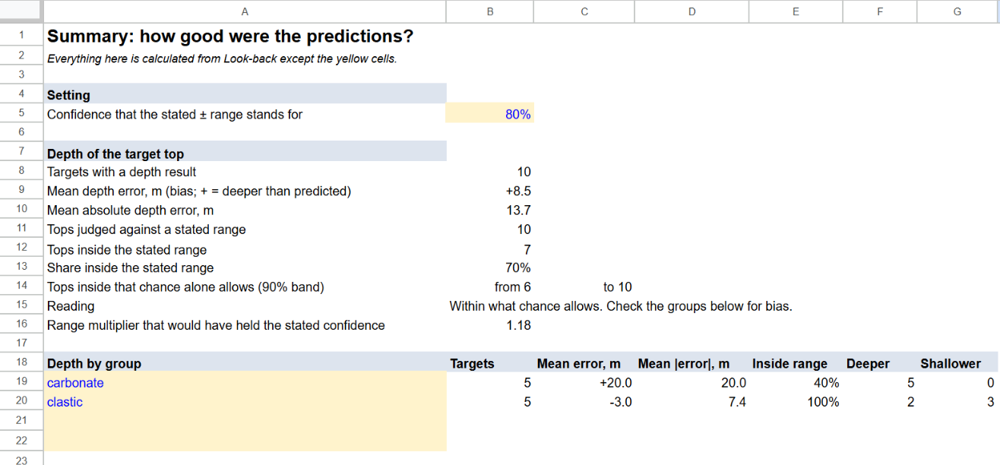
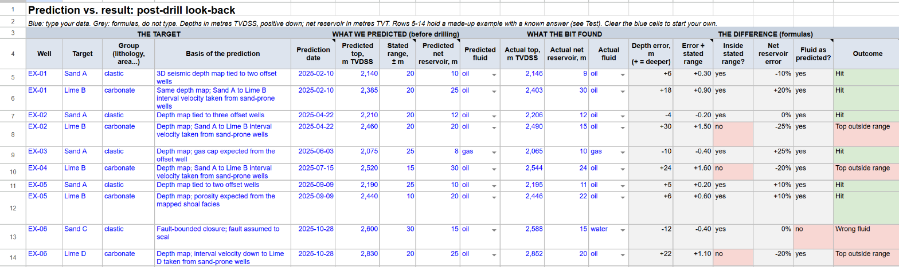
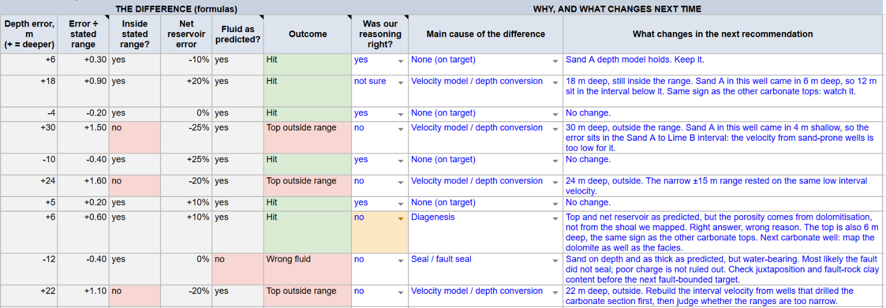

# Prediction vs. result

English · [Русский](README.ru.md)

**A post-drill look-back template for well predictions, in Excel.**

A well recommendation is a prediction. After drilling, I go back and check it against what the bit found. A hit can be right for the wrong reason, and misses often share a cause. This workbook keeps that check in one place: one row per target, filled in before drilling and again after.

For geologists who recommend wells and the managers who sign them off.

**[Download the workbook (.xlsx)](https://github.com/maxim-balaguroff/how-sure/raw/main/01-prediction-vs-result/prediction-vs-result.xlsx)** · [One page, PDF](prediction-vs-result-one-page.pdf) · [Одна страница по-русски, PDF](prediction-vs-result-one-page.ru.pdf)

## What it tells you

- **Bias by group.** Do tops come in deep or shallow, and in which group? In the example, all five carbonate tops came in deep and the clastic sands did not.
- **Calibration, with chance allowed for.** A range signed at P10-P90 should hold about eight times in ten. Summary shows how many tops landed inside, how many chance alone would allow, and the range multiplier that would have held the stated confidence.
- **Hits for the wrong reason.** Right depth, wrong geology. A plain hit rate never shows them.
- **Causes that repeat.** One main cause per target, counted across wells, so the next recommendation fixes the cause rather than widening every range.

## How it works

1. **Before drilling**, fill the blue *What we predicted* columns on Look-back: the date, the top with the ± range you are ready to sign, the net reservoir, the fluid, and what the prediction rests on. Leave them as they are once the well is spudded.
2. **After drilling**, fill *What the bit found*. The grey columns work out the depth error, the error in units of your range, the net reservoir error, whether the fluid matched, and the outcome.
3. **For every target, hits included**, record whether the reasoning was right, the main cause of the difference, and what changes in the next recommendation.

## Sheets

| Sheet | What is on it |
|---|---|
| Start | How to use it, conventions, colour key. |
| Look-back | One row per target. Blue columns hold the prediction and the result; grey columns hold the formulas; the last columns hold the cause and the lesson. |
| Summary | Depth bias and spread, overall and for up to four groups (type their names in the yellow cells). Tops inside the stated range against the band chance allows, with a one-line reading. Net reservoir, fluid, outcomes, hits for the wrong reason, causes. |
| Test | 32 results from the example compared with hand-worked answers. |
| Lists | Drop-down lists of causes, fluids and answers. Edit them for your area. |

## Checked against a known answer

The example is ten targets in six made-up wells, carbonate and clastic. I worked the answers out by hand and typed them into the Test sheet, which compares them with the workbook line by line. With the example in place, Test reads **ALL 32 PASS**.

The same 32 numbers were recomputed by separate code and by an independent spreadsheet-formula engine, and the workbook was recalculated in Google Sheets. All of them agree. Flip the sign of the depth error in one row (Look-back M8) and four lines turn to FAIL. Change or clear the example and Test reads *checks off: example changed or cleared*. Typing units into a number cell or leaving a range at zero gives a blank, not an error.

## Limits

- It counts and compares. The cause and the lesson stay a geologist's call, and it does not replace a post-well report or a velocity study.
- The ± range is treated as symmetric. If your P10 and P90 sit unevenly around the P50, use the wider half.
- The range multiplier pools all groups. If one group is biased, fix the bias before widening anything.
- One main cause per target. If two mattered, pick the one that moved the number most and name the other in the lesson.
- The outcome looks at the top and the fluid. Net reservoir error is shown but does not change the outcome.
- A small sample says little. The chance band on Summary shows how little: with 10 targets at 80%, anything from 6 to 10 inside is ordinary.
- A prediction written down after spud is not a prediction. The date column is there to keep that honest.

## Conventions

- Depths in metres TVDSS, positive down. A positive depth error means the top came in deeper than predicted.
- Net reservoir in metres true vertical thickness, with the same cut-offs before and after drilling.
- The ± range is half of the range you were ready to sign. If you sign P10-P90, set the confidence on Summary to 80%.
- The formulas use only functions Excel has had since 2007. No macros, no add-ins, no external links.

## Files

| File | What it is |
|---|---|
| `prediction-vs-result.xlsx` | The template, with the made-up example in place. |
| `prediction-vs-result-one-page.pdf` | The idea on one page, with the example chart. Also as `.png`. |
| `prediction-vs-result-one-page.ru.pdf` | The same page in Russian. Also as `.png`. |
| `screenshot-*.png` | The screenshots on this page. |

All numbers are made up; no company data. Built with AI assistance; the geology and the checks are mine.

Licence: [CC BY 4.0](../LICENSE). Maxim Balagurov, petroleum geologist · v1.0, November 2026 · DOI [10.5281/zenodo.24242389](https://doi.org/10.5281/zenodo.24242389)
