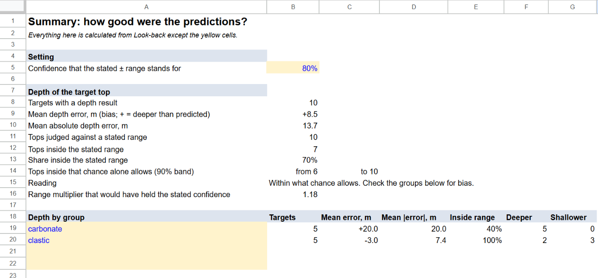
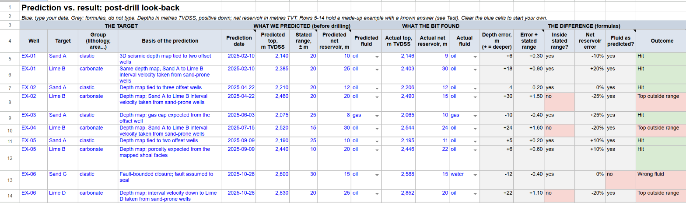
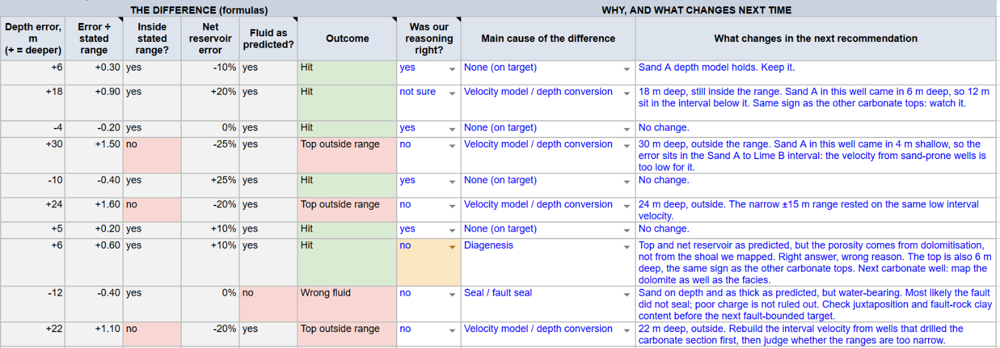

# Прогноз против результата

[English](README.md) · Русский

**Шаблон Excel для разбора прогнозов по скважинам после бурения (look-back).**

Рекомендуя скважину, геолог даёт прогноз. После бурения я возвращаюсь к нему и сверяю с тем, что вскрыло долото. Попадание бывает верным по неверной причине, а у промахов часто одна общая причина. Книга держит эту сверку в одном месте: одна строка на цель, заполняется до бурения и ещё раз после.

Для геологов, которые рекомендуют скважины, и руководителей, которые эти рекомендации подписывают.

**[Скачать книгу (.xlsx)](https://github.com/maxim-balaguroff/how-sure/raw/main/01-prediction-vs-result/prediction-vs-result.xlsx)** · [Одна страница, PDF](prediction-vs-result-one-page.ru.pdf) · [One page in English, PDF](prediction-vs-result-one-page.pdf)

Листы и подписи в книге на английском.

## Что он показывает

- **Смещение по группам.** Приходят ли кровли глубже или мельче прогноза и в какой группе? В примере все пять карбонатных кровель пришли глубже, а терригенные нет.
- **Калибровку с поправкой на случай.** Диапазон P10–P90 должен держаться примерно восемь раз из десяти. Лист Summary показывает, сколько кровель попало в диапазон, сколько допускает сам случай и во сколько раз пришлось бы расширить диапазоны, чтобы удержать заявленную уверенность.
- **Попадания по неверной причине.** Глубина верна, геология нет. Простой процент попаданий их не показывает.
- **Повторяющиеся причины.** Одна главная причина на цель, подсчёт по всем скважинам: следующая рекомендация исправляет причину, а не расширяет все диапазоны подряд.

## Как это работает

1. **До бурения** заполните на листе Look-back синие колонки *What we predicted*: дату, кровлю с диапазоном ±, под которым готовы подписаться, эффективную толщину, флюид и на чём стоит прогноз. После начала бурения их не трогайте.
2. **После бурения** заполните *What the bit found*. Серые колонки сами посчитают ошибку по глубине, ошибку в долях диапазона, ошибку по эффективной толщине, совпал ли флюид и исход.
3. **По каждой цели, включая попадания**, запишите, верной ли была логика, главную причину расхождения и что меняется в следующей рекомендации.

## Листы

| Лист | Что на нём |
|---|---|
| Start | Как пользоваться, условные обозначения, цвета. |
| Look-back | Одна строка на цель. Синие колонки: прогноз и результат; серые: формулы; в последних колонках причина и вывод. |
| Summary | Смещение и разброс по глубине, в целом и до четырёх групп (названия вписываются в жёлтые ячейки). Доля кровель внутри заявленного диапазона против полосы, которую допускает случай, и вывод одной строкой. Эффективная толщина, флюид, исходы, попадания по неверной причине, причины. |
| Test | 32 результата примера против ответов, посчитанных вручную. |
| Lists | Выпадающие списки причин, флюидов и ответов. Их можно править под свой район. |

## Проверено на известном ответе

Пример: десять целей в шести выдуманных скважинах, карбонатные и терригенные. Ответы я посчитал вручную и вписал на лист Test, который сравнивает их с книгой построчно. Пока пример на месте, Test показывает **ALL 32 PASS**.

Те же 32 числа пересчитаны отдельным кодом и независимым вычислителем табличных формул, а саму книгу пересчитали в Google Таблицах. Всё сходится. Если поменять знак ошибки по глубине в одной строке (Look-back M8), четыре строки покажут FAIL. Если изменить или стереть пример, Test покажет *checks off: example changed or cleared*. Единицы, вписанные в числовую ячейку, или нулевой диапазон дают пустую ячейку, а не ошибку.

## Ограничения

- Шаблон считает и сравнивает. Причина и вывод остаются за геологом; он не заменяет отчёт по скважине и скоростной анализ.
- Диапазон ± считается симметричным. Если P10 и P90 лежат вокруг P50 неравномерно, берите бо́льшую половину.
- Множитель диапазона считается по всем группам вместе. Если одна группа смещена, сначала исправьте смещение, потом расширяйте.
- Одна главная причина на цель. Если важны были две, выберите ту, что сильнее сдвинула число, а вторую назовите в выводе.
- Исход учитывает кровлю и флюид. Ошибка по эффективной толщине видна, но на исход не влияет.
- Малая выборка говорит мало. Полоса случая на листе Summary показывает, насколько мало: при 10 целях и 80 % внутри может оказаться от 6 до 10, и это обычно.
- Прогноз, записанный после начала бурения, уже не прогноз. Для этого и нужна колонка с датой.

## Условности

- Глубины в метрах, абсолютные отметки (TVDSS), вниз положительно. Положительная ошибка значит, что кровля пришла глубже прогноза.
- Эффективная толщина в метрах по вертикали, с одинаковыми граничными значениями до и после бурения.
- Диапазон ± равен половине диапазона, под которым вы готовы подписаться. Если подписываете P10–P90, поставьте на листе Summary уверенность 80 %.
- Формулы используют только функции, которые есть в Excel с 2007 года. Без макросов, надстроек и внешних ссылок.

## Файлы

| Файл | Что это |
|---|---|
| `prediction-vs-result.xlsx` | Шаблон с выдуманным примером. |
| `prediction-vs-result-one-page.ru.pdf` | Мысль на одной странице, с диаграммой примера. Есть и `.png`. |
| `prediction-vs-result-one-page.pdf` | Та же страница на английском. Есть и `.png`. |
| `screenshot-*.png` | Снимки листов с этой страницы. |

Все числа выдуманы, данных компаний нет. Сделано с помощью ИИ; геология и проверки мои.

Лицензия: [CC BY 4.0](../LICENSE). Максим Балагуров, геолог-нефтяник · v1.0, ноябрь 2026 · DOI [10.5281/zenodo.24242389](https://doi.org/10.5281/zenodo.24242389)
