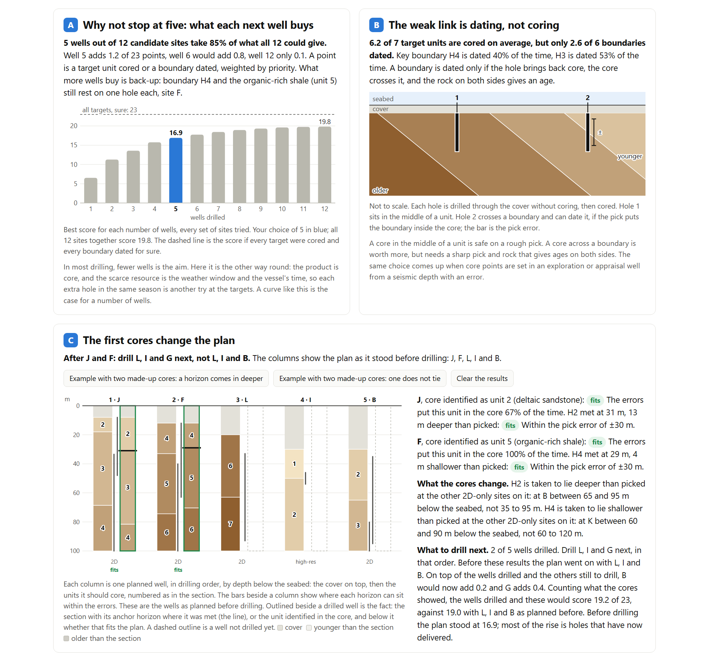

# Five wells: which five?

English · [Русский](README.ru.md)

**Planning a shallow stratigraphic drilling campaign when only a few wells are allowed: which sites to drill, what their cores can date, and what the first cores change.**

Where older units come up beneath the seabed, short cored holes give the first hard data on source rock, reservoir and seal in a basin with no wells, years before an exploration well. My part as the geologist: planning and supervision of the first shallow stratigraphic drilling campaign on the Russian Arctic shelf (Malyshev et al., 2023, which I co-authored): 10 wells, 300 m of core, 13 stratigraphic units. The campaign was planned for five wells and drilled ten in one season. The results are published ([doi:10.2113/RGG20224459](https://doi.org/10.2113/RGG20224459)). The trade press reported the drilling as the first stratigraphic wells in the region and the northernmost on the Russian shelf ([Oil & Gas Journal](https://www.ogj.com/exploration-development/area-drilling/article/14188292/rosneft-advances-arctic-shelf-stratigraphic-drilling); see also [Offshore Magazine](https://www.offshore-mag.com/drilling-completion/article/14185634/rosneft-drilling-shallow-wells-in-kara-sea-offshore-northern-russia)), and I appeared in a [Discovery Channel documentary](https://www.youtube.com/watch?v=AQ63fgCh6uk) on the Arctic drilling campaign.

This page shows, on made-up numbers, how such a campaign is reasoned when attempts are few. It opens on three findings; the form to try your own section is below them.

**[Open the page](https://maxim-balaguroff.github.io/how-sure/03-shallow-wells-plan/shallow-wells-plan.html)** · [download the file](https://github.com/maxim-balaguroff/how-sure/releases/latest/download/shallow-wells-plan.html) (one HTML file, works offline) · one page: [PDF](five-wells-one-page.pdf)

## Three findings

**A. Why not stop at five: what each next well buys.** In the example, five wells out of twelve candidate sites take 85 % of what all twelve could give; the fifth adds 1.2 points of 23, the sixth 0.8, the twelfth 0.1. What the extra wells buy is back-up: the source rock and one key boundary still rest on a single hole. In most drilling, fewer wells is the aim. Here it is the other way round: the product is core, and the scarce resource is the weather window and the vessel's time, so each extra hole in the same season is another try at the targets.

**B. The weak link is dating, not coring.** Six of seven target units are cored on average, yet fewer than three of six boundaries are dated. A boundary is dated only if the hole brings back core, the core crosses it, and the rock on both sides gives an age. A core in the middle of a unit is safe on a rough pick; a core across a boundary is worth more, but needs a sharp one.

**C. The first cores change the plan.** Enter what a core showed. If it fits, the page narrows where that horizon can lie at the other sites and chooses the remaining wells again. In the example the fifth well changes after two cores, mainly because the first hole brought back what its back-up was planned for. If a core does not tie, the sites still to drill on that horizon are held until it is re-picked.

## Where else this applies

The page is about shallow drilling offshore. A related question comes up elsewhere:

- **Core points in an exploration or appraisal well.** The same choice, the middle of the target or across its top, when the depth of that top comes from seismic with an error.
- **Shallow core holes near outcrop, in clastic and carbonate sections alike.** There the tie is to an outcrop rather than to a seismic pick, but where to place a few short cored holes is a question of the same kind: shallow core holes drilled in northern Saudi Arabia to study the Devonian and correlate it with nearby outcrops ([Breuer et al., 2015](https://doi.org/10.1016/j.revpalbo.2014.09.005)), and a 50 m core taken at a Jurassic carbonate outcrop in central Saudi Arabia as a continuous record like that of a cored reservoir well ([Ramdani et al., 2022](https://doi.org/10.17632/3dbx4tgv9s.1), a published core dataset).
- **Stratigraphic drilling by geological surveys.** In Australia's National Drilling Initiative a campaign is a handful of stratigraphic holes, with sites chosen on several criteria at once ([MinEx CRC](https://minexcrc.com.au/ndi-drilling-campaigns/)). The targets there are mineral systems; choosing a few sites to learn the most is a related problem.

## Using it

1. Open the page and read the three findings on the example.
2. Look at the checks at the bottom: **ALL 49 PASS**, against hand calculations and an independent count ([`sites_ref.py`](sites_ref.py)).
3. Then enter your own section, candidate sites and error ranges under "Try your own section".

How the page counts, the rules it uses, the example in full and the limits are in [how-it-works.md](how-it-works.md). The three limits that matter most: the numbers are made up; errors are taken within the ranges you enter, so a wrong reflector shows only after drilling, as a core that does not tie; and the page cannot re-pick a horizon, which takes the seismic and the whole core description.

## Files

| File | What it is |
|---|---|
| [`shallow-wells-plan.html`](shallow-wells-plan.html) | The page: one file, no internet needed, no data leaves the browser |
| [`five-wells-one-page.pdf`](five-wells-one-page.pdf) | One page: the campaign, the three findings, the links ([Russian](five-wells-one-page.ru.pdf)) |
| [`how-it-works.md`](how-it-works.md) | The count, the rules, the example in full, the checks, the limits |
| [`sites_ref.py`](sites_ref.py) | The independent count behind the checks (Python, numpy) |
| `screenshot-page.png` | The page on its example |

References: Bugge, T., et al. (2002). Shallow stratigraphic drilling applied in hydrocarbon exploration of the Nordkapp Basin, Barents Sea. *Marine and Petroleum Geology*, 19, 13–37. Malyshev, N. A., et al. (2023). Stratigraphic drilling in the northern Kara Sea: first case and preliminary results. *Russian Geology and Geophysics*, 64(3), 257–269. [doi:10.2113/RGG20224459](https://doi.org/10.2113/RGG20224459)

Built with AI assistance; the geology and the checks are mine.

Licence: [CC BY 4.0](../LICENSE). Maxim Balagurov, petroleum geologist · v1.2 · DOI [10.5281/zenodo.24242389](https://doi.org/10.5281/zenodo.24242389)
