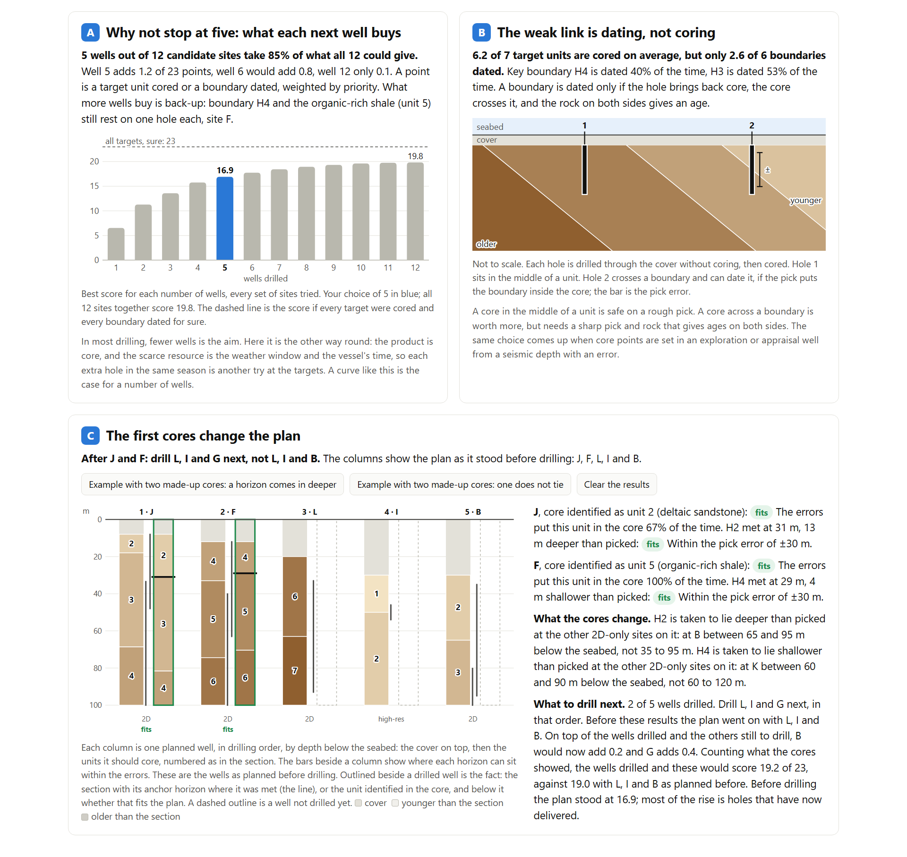

# Пять скважин: какие пять?

[English](README.md) · Русский

**Как планировать мелкое стратиграфическое бурение, когда скважин мало: какие точки бурить, что их керн сможет датировать и что меняют первые керны.**

Где более древние подразделения выходят под дно, короткие скважины с отбором керна дают первые прямые данные о нефтематеринских породах, коллекторах и покрышках в бассейне без скважин, за годы до первой поисковой скважины. Моя роль как геолога: планирование и сопровождение первого мелкого стратиграфического бурения на российском арктическом шельфе (Malyshev et al., 2023, я соавтор статьи): 10 скважин, 300 м керна, 13 стратиграфических подразделений. Результаты опубликованы ([doi:10.2113/RGG20224459](https://doi.org/10.2113/RGG20224459)). Отраслевая пресса писала об этом бурении как о первых стратиграфических скважинах в регионе и самых северных на российском шельфе ([Oil & Gas Journal](https://www.ogj.com/exploration-development/area-drilling/article/14188292/rosneft-advances-arctic-shelf-stratigraphic-drilling); см. также [Offshore Magazine](https://www.offshore-mag.com/drilling-completion/article/14185634/rosneft-drilling-shallow-wells-in-kara-sea-offshore-northern-russia)), а сам я снялся в [документальном фильме Discovery Channel](https://www.youtube.com/watch?v=AQ63fgCh6uk) об этой арктической буровой кампании.

Эта страница на выдуманных числах показывает ход рассуждения в такой кампании, когда попыток мало. Она открывается тремя выводами; форма для своего разреза ниже.

**[Открыть страницу](https://maxim-balaguroff.github.io/how-sure/03-shallow-wells-plan/shallow-wells-plan.html)** · [скачать файл](https://github.com/maxim-balaguroff/how-sure/releases/latest/download/shallow-wells-plan.html) (один HTML-файл, работает без интернета) · одна страница: [PDF](five-wells-one-page.ru.pdf). Сама страница на английском.

## Три вывода

**А. Почему не остановиться на пяти: что даёт каждая следующая скважина.** В примере пять скважин из двенадцати точек-кандидатов берут 85 % того, что могли бы дать все двенадцать; пятая добавляет 1,2 балла из 23, шестая 0,8, двенадцатая 0,1. Лишние скважины дают дублирование: нефтематеринская толща и одна ключевая граница по-прежнему держатся на одной скважине. Обычно в бурении стремятся к меньшему числу скважин. Здесь наоборот: нужен керн, а в дефиците погодное окно и время судна, поэтому каждая лишняя скважина в тот же сезон даёт ещё одну попытку достать цели.

**Б. Слабое звено: датировка, а не керн.** В среднем керном взяты шесть целевых подразделений из семи, а датировано меньше трёх границ из шести. Граница датирована, только если скважина дала керн, керн пересёк границу и порода по обе стороны дала возраст. Керн в середину подразделения надёжен и при грубой пикировке; керн через границу ценнее, но требует точной.

**В. Первые керны меняют план.** Введите, что показал керн. Если он сходится с планом, страница сужает положение этого горизонта в остальных точках и заново выбирает оставшиеся скважины. В примере после двух кернов меняется пятая скважина, главным образом потому, что первая скважина уже дала то, ради чего планировался её дублёр. Если увязка не подтвердилась, ещё не пробуренные точки на этом горизонте придержаны, пока его не перепикируют.

## Где ещё это применимо

Страница посвящена мелкому бурению на шельфе. Близкий вопрос встаёт и в других местах:

- **Интервалы отбора керна в поисковой или оценочной скважине.** Тот же выбор, середина цели или через её кровлю, когда глубина кровли снята с сейсмики с ошибкой.
- **Мелкие скважины с керном у обнажений, и в терригенных, и в карбонатных разрезах.** Там увязка идёт с обнажением, а не с пикировкой по сейсмике, но вопрос, где поставить несколько коротких скважин с керном, того же рода: мелкие скважины с керном на севере Саудовской Аравии для изучения девона и его корреляции с соседними обнажениями ([Breuer et al., 2015](https://doi.org/10.1016/j.revpalbo.2014.09.005)) и керн длиной 50 м у обнажения юрских карбонатов в центре Саудовской Аравии как непрерывная запись разреза, подобная керну скважины в резервуаре ([Ramdani et al., 2022](https://doi.org/10.17632/3dbx4tgv9s.1), опубликованный набор данных по керну).
- **Стратиграфическое бурение геологических служб.** В австралийской National Drilling Initiative кампания состоит из нескольких стратиграфических скважин, а точки выбирают сразу по нескольким критериям ([MinEx CRC](https://minexcrc.com.au/ndi-drilling-campaigns/)). Цели там рудные системы; выбрать немногие точки так, чтобы узнать больше всего, задача родственная.

## Как пользоваться

1. Откройте страницу и прочтите три вывода на примере.
2. Посмотрите проверки внизу: **ALL 49 PASS**, против ручного счёта и независимого расчёта ([`sites_ref.py`](sites_ref.py)).
3. Потом введите свой разрез, точки-кандидаты и пределы ошибок в разделе «Try your own section».

Как страница считает, какие правила использует, пример целиком и ограничения описаны в [how-it-works.ru.md](how-it-works.ru.md). Три главных ограничения: числа выдуманы; ошибки берутся в введённых пределах, поэтому пикировка не того отражения видна только после бурения, как керн, который не сходится; перепикировать горизонт страница не может, для этого нужны сейсмика и полное описание керна.

## Файлы

| Файл | Что это |
|---|---|
| [`shallow-wells-plan.html`](shallow-wells-plan.html) | Страница: один файл, интернет не нужен, данные не покидают браузер |
| [`five-wells-one-page.ru.pdf`](five-wells-one-page.ru.pdf) | Одна страница: кампания, три вывода, ссылки ([английская](five-wells-one-page.pdf)) |
| [`how-it-works.ru.md`](how-it-works.ru.md) | Расчёт, правила, пример целиком, проверки, ограничения |
| [`sites_ref.py`](sites_ref.py) | Независимый расчёт для проверок (Python, numpy) |
| `screenshot-page.png` | Страница на примере |

Источники: Bugge, T., et al. (2002). Shallow stratigraphic drilling applied in hydrocarbon exploration of the Nordkapp Basin, Barents Sea. *Marine and Petroleum Geology*, 19, 13–37. Malyshev, N. A., et al. (2023). Stratigraphic drilling in the northern Kara Sea: first case and preliminary results. *Russian Geology and Geophysics*, 64(3), 257–269. [doi:10.2113/RGG20224459](https://doi.org/10.2113/RGG20224459)

Сделано с помощью ИИ; геология и проверки мои.

Лицензия: [CC BY 4.0](../LICENSE). Максим Балагуров, геолог-нефтяник · v1.2 · DOI [10.5281/zenodo.24242389](https://doi.org/10.5281/zenodo.24242389)
