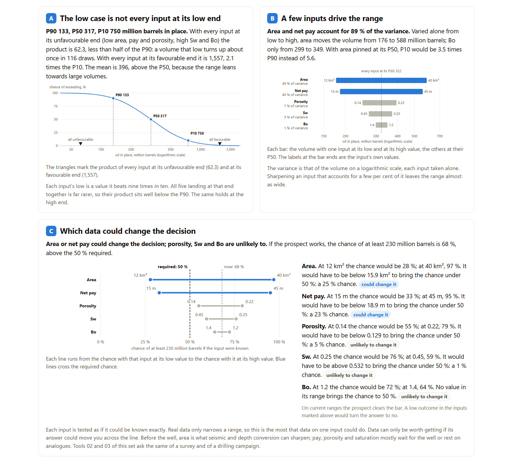

# How much, and how sure?

English · [Русский](README.ru.md)

**A prospect's oil in place as a range, P90 to P10: where the range comes from, which inputs drive it, and which data could change the decision.**

Before a well is drilled, a volume is a product of things nobody has measured yet: the area of the closure, the pay, the rock and the fluid. The honest answer is a range. In my own work as a petroleum geologist I ran probabilistic volumetrics (P90/P50/P10) using a Monte Carlo spreadsheet; this tool shows the reasoning. Oil in place is stock-tank oil initially in place (STOIIP). P90 is the low case, the volume exceeded with a 90 % chance; P10 is the high case.

The page works on made-up numbers. It opens on three findings; the form to try your own prospect is below them. The same calculation is in a spreadsheet.

**[Open the page](https://maxim-balaguroff.github.io/how-sure/04-volume-range/volume-range.html)** · [download the file](https://github.com/maxim-balaguroff/how-sure/releases/latest/download/volume-range.html) (one HTML file, works offline) · the spreadsheet: [Excel](https://github.com/maxim-balaguroff/how-sure/raw/main/04-volume-range/volume-range.xlsx) · one page: [PDF](volume-range-one-page.pdf)

## Three findings

**A. The low case is not every input at its low end.** In the example P90 is 133, P50 317 and P10 750 million barrels in place. With every input at its unfavourable end the product is 62, less than half of the P90: a volume that low turns up about once in 116 draws. With every input at its favourable end it is 1,557, twice the P10. The mean, 396, sits above the P50 because the range leans towards large volumes.

**B. A few inputs drive the range.** Area and net pay account for 89 % of the variance. Varied alone from low to high, area moves the volume from 176 to 588 million barrels; the oil formation volume factor only from 299 to 349. With area pinned at its P50, P10 would be 3.5 times P90 instead of 5.6. Sharpening an input that accounts for a few per cent leaves the range almost as wide.

**C. Which data could change the decision.** If the prospect works, the chance of the 230 million barrels it needs is 68 %, against the 50 % required. Area would have to come in below 15.9 km² to bring that chance under 50 %, which is a 25 % chance; net pay below 18.9 m, a 23 % chance. Porosity would have to be below 0.129, a 5 % chance, and no value of the volume factor does it. Data can only be worth getting if its answer could move you across the line, and before the well it is area that seismic and depth conversion can sharpen.

## How it fits with the other tools

- **Tool 01** looks back at past predictions and shows whether their ranges held. If they were too narrow, "Widen all input ranges" on this page applies the correction: in the example, ranges 1.5 times as wide take P90 from 133 down to 83.
- **Tools 02 and 03** ask finding C's question of a survey and of a drilling campaign: what must the data resolve to be worth getting.

## Using it

1. Open the page and read the three findings on the example.
2. Look at the checks at the bottom: **ALL 74 PASS**, against answers worked out by hand and an independent calculation ([`volume_ref.py`](volume_ref.py)).
3. Then enter your own low and high values under "Try your own prospect", the minimum volume to justify a well, and the required chance.
4. Or work in the spreadsheet: the Test sheet reads **ALL 38 PASS** while the example is in place. It works on 8,000 stored points with no macros, sits within 1 % of the page on the example, and has been recalculated in Google Sheets.

The three limits that matter most: the numbers are made up; the range is only as good as the input ranges; and this is the volume if the prospect works, so the chance that there is a trap, a reservoir, a seal and a charge at all is a separate number. The page lists the rest.

## Files

| File | What it is |
|---|---|
| [`volume-range.html`](volume-range.html) | The page: one file, no internet needed, no data leaves the browser |
| [`volume-range.xlsx`](volume-range.xlsx) | The same calculation as a spreadsheet: 8,000 stored points, a Test sheet, no macros |
| [`volume-range-one-page.pdf`](volume-range-one-page.pdf) | One page: the example, the three findings, the limits, the links ([Russian](volume-range-one-page.ru.pdf)) |
| [`volume_ref.py`](volume_ref.py) | The independent calculation behind the checks (Python, numpy) |
| `screenshot-page.png` | The page on its example |

Built with AI assistance; the geology and the checks are mine.

Licence: [CC BY 4.0](../LICENSE). Maxim Balagurov, petroleum geologist · v1.3 · DOI [10.5281/zenodo.24242389](https://doi.org/10.5281/zenodo.24242389)
