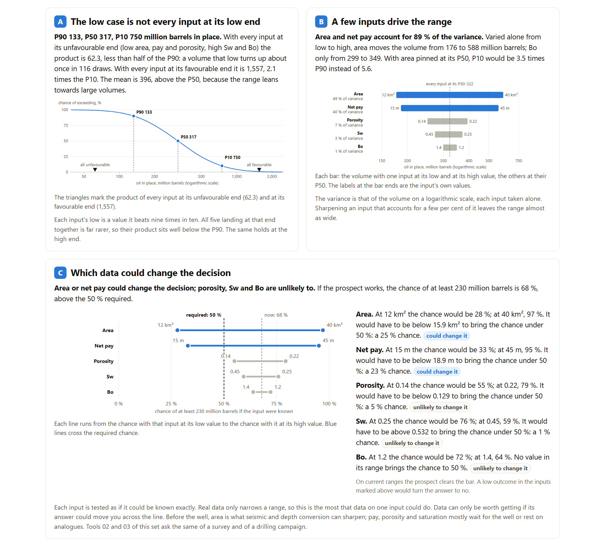

# Сколько и насколько уверенно?

[English](README.md) · Русский

**Геологические ресурсы нефти перспективного объекта как диапазон от P90 до P10: откуда берётся диапазон, какие параметры дают основной разброс и какие данные могли бы изменить решение.**

До бурения объём равен произведению величин, которые ещё никто не измерил: площади ловушки, эффективной нефтенасыщенной толщины, свойств породы и флюида. Честно ответить можно только диапазоном. В своей работе геолога-нефтяника я вёл вероятностную оценку ресурсов (P90/P50/P10) методом Монте-Карло в таблице; этот инструмент показывает ход рассуждения. P90 здесь нижняя оценка: объём, который будет превышен с вероятностью 90 %; P10 верхняя.

Страница работает на выдуманных числах. Она открывается тремя выводами; форма для своего объекта ниже. Тот же расчёт есть в таблице.

**[Открыть страницу](https://maxim-balaguroff.github.io/how-sure/04-volume-range/volume-range.html)** · [скачать файл](https://github.com/maxim-balaguroff/how-sure/releases/latest/download/volume-range.html) (один HTML-файл, работает без интернета) · таблица: [Excel](https://github.com/maxim-balaguroff/how-sure/raw/main/04-volume-range/volume-range.xlsx) · одна страница: [PDF](volume-range-one-page.ru.pdf). Страница и таблица на английском.

## Три вывода

**А. Нижняя оценка не равна произведению нижних значений.** В примере P90 равен 133, P50 317, P10 750 млн баррелей геологических ресурсов. Если взять каждый параметр на его неблагоприятном краю, произведение даёт 62, меньше половины P90: такой низкий объём выпадает примерно в одном случае из 116. Произведение благоприятных значений даёт 1 557, вдвое больше P10. Среднее, 396, выше P50, потому что диапазон вытянут в сторону больших объёмов.

**Б. Диапазон задают один-два параметра.** На площадь и эффективную толщину приходится 89 % дисперсии. Если менять по одному параметру от нижнего значения до верхнего, площадь двигает объём от 176 до 588 млн баррелей, а объёмный коэффициент нефти только от 299 до 349. Если закрепить площадь на её P50, P10 превышал бы P90 в 3,5 раза вместо 5,6. Уточнение параметра, на который приходится несколько процентов, диапазон почти не сужает.

**В. Какие данные могли бы изменить решение.** Если объект окажется продуктивным, вероятность нужных ему 230 млн баррелей равна 68 % при требуемых 50 %. Чтобы эта вероятность упала ниже 50 %, площадь должна оказаться меньше 15,9 км², на это 25 % шансов; эффективная толщина меньше 18,9 м, 23 % шансов. Пористость должна быть ниже 0,129, это 5 % шансов, а объёмный коэффициент не меняет ответа ни при каком значении. Данные стоит получать только тогда, когда их ответ может перевести через черту, а до скважины уточнить можно именно площадь: сейсмикой и пересчётом времени в глубину.

## Как это связано с другими инструментами

- **Инструмент 01** разбирает прошлые прогнозы и показывает, держались ли их диапазоны. Если они были узки, переключатель «Widen all input ranges» на странице вносит поправку: в примере диапазоны шире в полтора раза опускают P90 со 133 до 83.
- **Инструменты 02 и 03** задают тот же вопрос для съёмки и для программы бурения: что данные должны показать, чтобы их стоило получать.

## Как пользоваться

1. Откройте страницу и прочитайте три вывода на примере.
2. Посмотрите проверки внизу: **ALL 74 PASS**, по ответам, посчитанным вручную, и по независимому расчёту ([`volume_ref.py`](volume_ref.py)).
3. Потом внесите свои нижние и верхние значения в разделе «Try your own prospect», минимальный объём, при котором скважина оправдана, и требуемую вероятность.
4. Или работайте в таблице: пока пример на месте, лист Test показывает **ALL 38 PASS**. В ней 8 000 сохранённых точек без макросов; на примере она расходится со страницей меньше чем на 1 %, пересчёт проверен в Google Таблицах.

Три главных ограничения: числа выдуманы; диапазон хорош настолько, насколько хороши диапазоны параметров; это объём при условии, что объект окажется продуктивным, а вероятность того, что есть ловушка, коллектор, покрышка и заполнение, считается отдельно. Остальные перечислены на странице.

## Файлы

| Файл | Что это |
|---|---|
| [`volume-range.html`](volume-range.html) | Страница: один файл, интернет не нужен, данные не покидают браузер |
| [`volume-range.xlsx`](volume-range.xlsx) | Тот же расчёт в таблице: 8 000 сохранённых точек, лист Test, без макросов |
| [`volume-range-one-page.ru.pdf`](volume-range-one-page.ru.pdf) | Одна страница: пример, три вывода, ограничения, ссылки ([English](volume-range-one-page.pdf)) |
| [`volume_ref.py`](volume_ref.py) | Независимый расчёт, на котором стоят проверки (Python, numpy) |
| `screenshot-page.png` | Страница на примере |

Сделано с помощью ИИ; геология и проверки мои.

Лицензия: [CC BY 4.0](../LICENSE). Максим Балагуров, геолог-нефтяник · v1.3 · DOI [10.5281/zenodo.24242389](https://doi.org/10.5281/zenodo.24242389)
