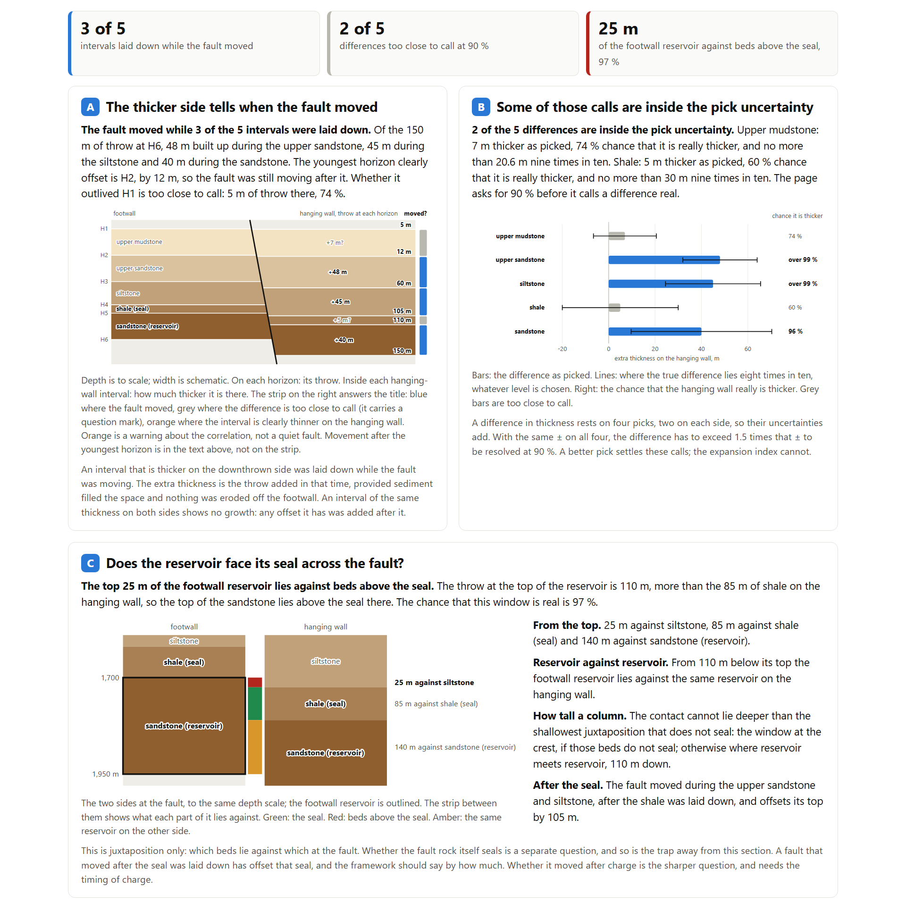

# When did the fault move?

English · [Русский](README.ru.md)

**One fault on a depth section, checked before it goes into the fault framework: which intervals it grew through, which of those calls are larger than the pick uncertainty, and whether the reservoir faces its seal across the fault.**

A fault framework is a set of decisions: which faults exist, how far they throw, when they moved. Each one rests on picks, and picks near a fault are the least certain ones on the section. In my own work as a petroleum geologist I interpret 3D seismic, build fault framework models and co-sign the exploration reports that rest on them. This page works through one check on a fault before it goes into the framework, on made-up numbers.

Published work on building a geological model of a structurally complex area: Balagurov et al., 2026, [Integrated Geophysical Interpretation for Geological Modeling of a Structurally Complex Region Influenced by Salt Tectonics and Magmatism (Eastern Siberia, Russia)](https://doi.org/10.1007/978-981-95-9869-4_83), Proceedings of IFEDC 2025, Springer. The example here is not taken from that paper.

The page opens on the example in three numbers and three findings. Under them it lists three things to do before signing, worked out from the same numbers. The form to try your own fault is below.

**[Open the page](https://maxim-balaguroff.github.io/how-sure/05-fault-timing/fault-timing.html)** · [download the file](https://github.com/maxim-balaguroff/how-sure/releases/latest/download/fault-timing.html) (one HTML file, works offline) · one page to print: [PDF](fault-timing-one-page.pdf)

## Three findings

**A. The thicker side tells when the fault moved.** An interval that is thicker on the downthrown side was laid down while the fault was moving. In the example the fault moved while three of the five intervals were laid down: of the 150 m of throw at the deepest horizon, 48 m built up during the upper sandstone, 45 m during the siltstone and 40 m during the reservoir sandstone. The youngest horizon clearly offset dates the last movement.

**B. Some of those calls are inside the pick uncertainty.** A difference in thickness rests on four picks, two on each side of the fault, so their uncertainties add. In the example two of the five differences cannot be told from zero: 7 m with a 74 % chance of being real, and 5 m with 60 %. With the same ± on all four picks, a difference has to exceed 1.5 times that ± to be resolved at 90 %. A better pick settles such a call; the expansion index cannot.

**C. Does the reservoir face its seal across the fault?** The throw at the top of the example reservoir is 110 m, more than the 85 m of seal on the hanging wall. So the top 25 m of the footwall reservoir lies against beds above the seal, with a 97 % chance that this window is real, and from 110 m down the reservoir lies against itself. The fault also kept moving after the seal was laid down. This is juxtaposition only; whether the fault rock seals is a separate question.

## How it fits with the other tools

- **Tool 04** turns ranges of area, pay and rock into a range of volume. The area in that range depends on where the faults are and whether they seal; this page is a check on one of them.
- **Tool 01** looks back at past predictions. A fault that was signed as sealing and turned out not to be belongs in that table, with its cause.

## Using it

1. Open the page and read the three findings on the example, then "Before signing: three things to do": which horizons to re-pick and to what ±, what to repeat on the neighbouring sections, and which beds above the seal to name.
2. Look at the checks at the bottom: **ALL 58 PASS**, against answers worked out by hand and an independent calculation ([`fault_ref.py`](fault_ref.py)).
3. Then enter your own horizons under "Try your own fault": the depth of each on the footwall and on the hanging wall, and how far each pick can be off.

The three limits that matter most: the numbers are made up; this is one section through the fault, and throw changes along strike; and it is juxtaposition only, with nothing about the fault rock. The page lists the rest, including what it assumes about pick uncertainty.

## Files

| File | What it is |
|---|---|
| [`fault-timing.html`](fault-timing.html) | The page: one file, no internet needed, no data leaves the browser |
| [`fault-timing-one-page.pdf`](fault-timing-one-page.pdf) · [`.ru.pdf`](fault-timing-one-page.ru.pdf) | One page to print and discuss, in English and Russian |
| [`fault_ref.py`](fault_ref.py) | The independent calculation behind the checks (Python, numpy) |
| `screenshot-page.png` | The page on its example |
| `cover.png` | The picture shown when the page is shared as a link |

Built with AI assistance; the geology and the checks are mine.

Licence: [CC BY 4.0](../LICENSE). Maxim Balagurov, petroleum geologist · v1.4 · DOI [10.5281/zenodo.24242389](https://doi.org/10.5281/zenodo.24242389)
