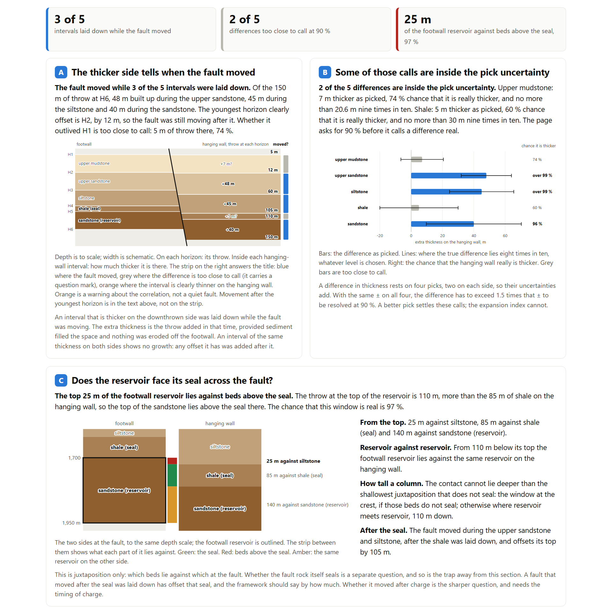

# Когда двигался разлом?

[English](README.md) · Русский

**Один разлом на глубинном разрезе, проверенный до того, как он войдёт в каркас разломов: пока накапливались какие интервалы, он рос, какие из этих разниц мощностей превышают неопределённость пикировки и контактирует ли коллектор по разлому со своей покрышкой.**

Каркас разломов состоит из решений: какие разломы есть, какая у них амплитуда, когда они двигались. Каждое опирается на пикировку, а у разлома она наименее надёжна. В своей работе геолога-нефтяника я интерпретирую сейсмику 3D, строю модели каркаса разломов и подписываю как соавтор отчёты по геологоразведке, которые на них опираются. Эта страница показывает одну проверку разлома перед тем, как он войдёт в каркас, на выдуманных числах.

Опубликованная работа о построении геологической модели структурно сложного района: Balagurov et al., 2026, [Integrated Geophysical Interpretation for Geological Modeling of a Structurally Complex Region Influenced by Salt Tectonics and Magmatism (Eastern Siberia, Russia)](https://doi.org/10.1007/978-981-95-9869-4_83), Proceedings of IFEDC 2025, Springer. Пример на странице взят не из этой статьи.

Страница открывается примером в трёх числах и тремя выводами. Под ними три действия перед подписью, посчитанные по тем же числам. Форма для своего разлома ниже.

**[Открыть страницу](https://maxim-balaguroff.github.io/how-sure/05-fault-timing/fault-timing.html)** · [скачать файл](https://github.com/maxim-balaguroff/how-sure/releases/latest/download/fault-timing.html) (один HTML-файл, работает без интернета) · одна страница для печати: [PDF](fault-timing-one-page.ru.pdf). Сама страница на английском.

## Три вывода

**А. Более мощное крыло показывает, когда двигался разлом.** Интервал, который в опущенном крыле мощнее, накапливался, пока разлом двигался. В примере разлом двигался, пока накапливались три интервала из пяти: из 150 м амплитуды по самому глубокому горизонту 48 м набралось за время накопления верхних песчаников, 45 м за время алевролитов и 40 м за время песчаников коллектора. Последнее движение датирует самый молодой горизонт, который явно смещён.

**Б. Часть этих выводов лежит внутри неопределённости пикировки.** Разница мощностей опирается на четыре отметки горизонтов, по две с каждой стороны разлома, и их неопределённости складываются. В примере две разницы из пяти не отличить от нуля: 7 м (вероятность того, что разница действительно есть, 74 %) и 5 м (60 %). Если у всех четырёх отметок одинаковое ±, разница должна превышать его в 1,5 раза, чтобы быть различимой на уровне 90 %. Такой вывод решает более точная пикировка, а не индекс роста (expansion index).

**В. Контактирует ли коллектор по разлому со своей покрышкой?** Амплитуда по кровле коллектора в примере равна 110 м, это больше 85 м покрышки в висячем крыле. Поэтому верхние 25 м коллектора лежачего крыла контактируют с породами выше покрышки (вероятность того, что это окно действительно есть, 97 %), а со 110 м ниже кровли коллектор контактирует с самим собой. Кроме того, разлом продолжал двигаться после накопления покрышки. Это только контакт пород по разлому; экранирует ли сама разломная зона, вопрос отдельный.

## Как это связано с другими инструментами

- **Инструмент 04** превращает диапазоны площади, эффективной толщины и свойств пород в диапазон объёма. Площадь в этом диапазоне зависит от того, где проходят разломы и экранируют ли они; эта страница проверяет один из них.
- **Инструмент 01** разбирает прошлые прогнозы. Разлом, который подписали как экранирующий, а он им не оказался, должен попасть в ту таблицу вместе с причиной.

## Как пользоваться

1. Откройте страницу и прочитайте три вывода на примере, затем блок «Before signing: three things to do»: какие горизонты пропикировать заново и до какого ±, что повторить на соседних разрезах и какие породы над покрышкой назвать.
2. Посмотрите проверки внизу: **ALL 58 PASS**, по ответам, посчитанным вручную, и по независимому расчёту ([`fault_ref.py`](fault_ref.py)).
3. Потом внесите свои горизонты в разделе «Try your own fault»: глубину каждого в лежачем и в висячем крыле и то, насколько может ошибаться каждая отметка.

Три главных ограничения: числа выдуманы; это один разрез через разлом, а амплитуда меняется по простиранию; это только контакт пород по разлому, о разломной зоне ничего не сказано. Остальные перечислены на странице, включая то, что она принимает о неопределённости пикировки.

## Файлы

| Файл | Что это |
|---|---|
| [`fault-timing.html`](fault-timing.html) | Страница: один файл, интернет не нужен, данные не покидают браузер |
| [`fault-timing-one-page.ru.pdf`](fault-timing-one-page.ru.pdf) · [`.pdf`](fault-timing-one-page.pdf) | Одна страница для печати и обсуждения, на русском и английском |
| [`fault_ref.py`](fault_ref.py) | Независимый расчёт, на котором стоят проверки (Python, numpy) |
| `screenshot-page.png` | Страница на примере |
| `cover.png` | Картинка, которая показывается, когда страницей делятся по ссылке |

Сделано с помощью ИИ; геология и проверки мои.

Лицензия: [CC BY 4.0](../LICENSE). Максим Балагуров, геолог-нефтяник · v1.4 · DOI [10.5281/zenodo.24242389](https://doi.org/10.5281/zenodo.24242389)
