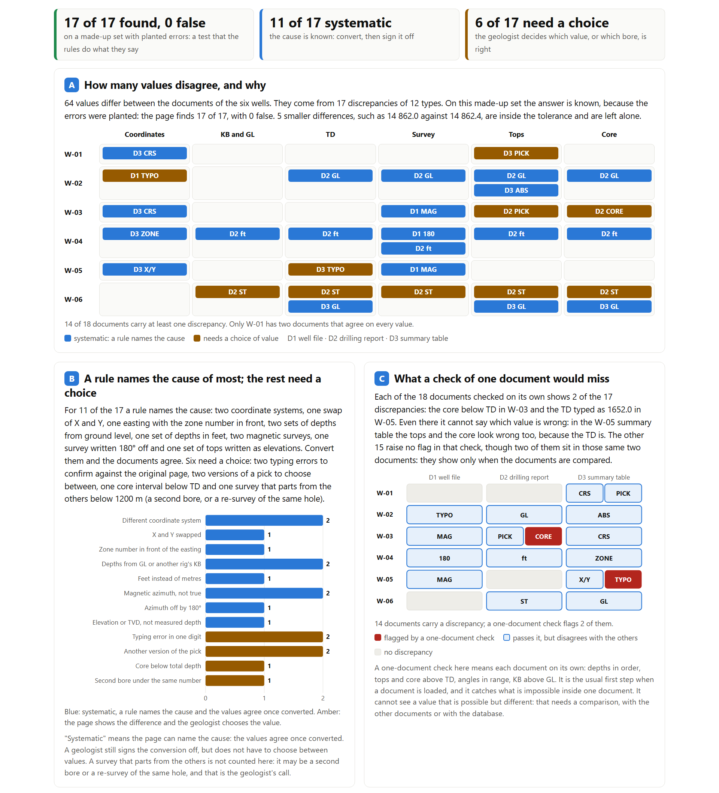

# Which document is right?

English · [Русский](README.ru.md)

**Six wells, three documents each, and the values do not agree. The page compares them, sorts every difference by its cause, and leaves to the geologist the ones that need a choice.**

Before historical wells go into a project database, the same value has to be read from several documents: the well file, the drilling report, a summary table compiled years later. They disagree, and most of the disagreements have a plain cause: another coordinate system, depths from ground level, feet, a magnetic survey, tops written as elevations. A few need a decision. On a pilot on a producing-field project I work with historical well data: wellhead coordinates, deviation surveys, picks, core and well files. There, by my own estimate, preparing the historical well data was about 1.5 to 2 times faster than by hand. AI reads and compares well; the decision on which document is right stays with the geologist. This page shows the logic of that check on made-up documents.

It does not read scans and runs no agents or language models: the values are typed in.

**[Open the page](https://maxim-balaguroff.github.io/how-sure/06-which-document/which-document.html)** · [download the file](https://github.com/maxim-balaguroff/how-sure/releases/latest/download/which-document.html) (one HTML file, works offline) · one page to print: [PDF](which-document-one-page.pdf)

## Three findings

**A. How many values disagree, and why.** In the made-up set 64 values differ between the documents of the six wells. They come from 17 discrepancies of 12 types. The errors were planted, so the answer is known: the page finds 17 of 17, with no false ones. Five smaller differences, such as 14 862.0 against 14 862.4, are inside the tolerance and are left alone.

**B. A rule names the cause of most; the rest need a choice.** For 11 of the 17 the cause is systematic: two coordinate systems, one swap of X and Y, one easting with the zone number in front, two sets of depths from ground level, one set of depths in feet, two magnetic surveys, one survey written 180° off and one set of tops written as elevations. Convert them and the documents agree; a geologist signs the conversion off. Six need a choice: two typing errors to confirm against the original page, two versions of a pick to choose between, one core interval below TD (either the core depth or the TD is wrong), and one survey that parts from the others below 1200 m, which may be a second bore under the same number or a re-survey of the same hole; its drilling report gives the KB of the rig that drilled it, 1.7 m lower than the first.

**C. What a check of one document would miss.** Each of the 18 documents checked on its own (depths in order, tops and core above TD, angles in range) shows 2 of the 17: the core below TD and a TD typed as 1652 instead of 1952. Even there it cannot say which value is wrong. The other 15 raise no flag in that check (13 of them are in documents that pass it), and show only when the documents are compared.

## The types

| Type | Class | How the page knows it |
|---|---|---|
| Different coordinate system | systematic | once converted, the points agree |
| X and Y swapped | systematic | X of one document is Y of the other |
| Zone number in front of the easting | systematic | the northing (X) agrees and the easting (Y) differs by a whole number of millions of metres (the zone, 1 to 60) |
| Depths from GL or another rig's KB | systematic | the document's depths are shallower by KB − GL, or it says GL; or it gives its own KB and its depths differ by just that much |
| Feet instead of metres | systematic | depths × 0.3048 equal those of another document; KB and GL go with them when they too agree once converted |
| Magnetic azimuth, not true | systematic | azimuths at 3° inclination or more differ from true by the declination (magnetic = true − declination, east positive), or the document says magnetic |
| Azimuth off by 180° | systematic | azimuths at 3° inclination or more differ by 180°: back bearings, or bearings measured from south |
| Elevation or TVD, not measured depth | systematic | the value equals KB − TVD, TVD − KB (TVDSS), TVD, or an elevation worked out from measured depth or from GL |
| Typing error in one digit | needs a choice | one digit differs, two neighbouring digits are swapped, or one is missing; for depths and coordinates, by 10 m or more |
| Another version of the pick | needs a choice | a top differs within the pick window (reinterpretation), 15 m by default |
| Core below total depth | needs a choice | the core interval lies below the agreed TD |
| Second bore under the same number | needs a choice | surveys, lined up by depth, agree at the top and part below; TDs differ (a sidetrack, or a re-survey of the same hole) |
| Constant depth shift, datum unknown | needs a choice | the depths are off by one amount that is not KB − GL |
| Constant azimuth offset | needs a choice | azimuths at 3° inclination or more are off by one angle that is not the declination (grid north, another declination) |

A rule on depths or azimuths holds when at least 80 % of the values compared fit it, and three or more are compared.

The last two types are not in the made-up set; the page's checks test them on small wells built for one type each. Two more outcomes go to the geologist without a rule: coordinate systems that differ with no transformation given, and a difference that no rule fits.

## Using it

1. Open the page and read the three findings on the made-up set, then the register of the six wells below: each discrepancy with the values of the three documents, the type, what to check, and a field for the decision. The register downloads as CSV, one line per value; the accepted values download as a ZIP (see below).
2. Look at the checks at the bottom: **ALL 130 PASS**, against answers worked out by hand, the list of planted errors, and an independent calculation ([`sverka_ref.py`](sverka_ref.py)) that finds the discrepancies and works out the accepted values with its own code.
3. Then enter one well of your own under "Try your own well": two or three documents, with the tolerances, the declination and the transformation between your coordinate systems.
4. Or paste a table of many wells under "Many wells at once", one line per document, or open it as a CSV file. The page reads it in the browser, matches well names written differently (W-04, w04, W 4) or with Cyrillic and Latin letters that look alike (С-12 and C-12), and gives a summary per well and one register for all of them. "Put the example wells here" shows the format; a `uwi` column, if there is one, goes into the export of accepted values.

Survey stations are lined up by depth, not by their order in the list: where a document has no station at a depth, its value is interpolated between its own stations, and a sidetrack survey that starts at its tie-in is compared from there down. Where two documents agree, they set the reference. Where none agree, as with two documents that differ, the reference is the document first in the order of priority: the one you give, or else a drilling report, then the well file, then a summary table. Where the record is the one that differs (a typing error, a pick, a core or a difference no rule fits), the hint says so: a summary table copied from the well file repeats its errors and can outvote the original.

The three limits that matter most: the numbers are made up; values are typed in, nothing is read from scans; and the page shows the difference and its likely cause, but which value is right is decided against the original pages. One more, for the export: if a total correction to grid north is entered instead of the declination, the azimuths corrected by it are to the grid, and `AZI_REF` still says `TrueNorth`; correct the label by hand before loading. The page lists the rest.

## Accepted values for a database or a GIS

Each register has a second button, "Accepted values, ZIP". It gives what goes next into a project database:

- `wellheads.csv`, `trajectory.csv`, `tops.csv`: plain CSV, UTF-8, one header line, commas, a decimal point, the unit in the name of every measured column (`KB_M`, `MD_M`, `INC_DEG`). Depths are measured depths from the KB of the reference document, azimuths to true north where `AZI_REF` says so; the trajectory has TVD, DX (east) and DY (north) by minimum curvature from a vertical start at the KB, and the tops have TVD and TVDSS. `UWI` joins the files.
- `wellheads.gpkg`: a GeoPackage layer of the wellheads (most columns of `wellheads.csv`), written in the browser without a library.
- `documents.csv`: the documents of each well and their order of priority; `*.csvt`: the column types, for QGIS; `osdu-fields.csv`: for each column the OSDU or WITSML field with the schema version and a link to the schema file, "not mapped", or "as in wellheads.csv"; `README.txt`: how to read and import the files.

The value of each field is the one the check accepts: the value two documents agree on, preferably from a document that needed no conversion, then the first in the order of priority among them; where no two agree, the document first in the order of priority. The trajectory is one document's whole survey, even at a station where the others outvote it; its status says so. A second bore gives no value where another document has one, and a top written as an elevation is never taken. Every row has a status: agreed, one document, converted (a rule names the cause), needs a choice, or tie point for the trajectory row at MD 0. It stays pending until each discrepancy on it has a decision in the register; a conversion is signed off by a decision too. A typed decision clears the mark and does not change the value: where it keeps another document's value, the value is changed by hand. A top waits while the KB or a survey station it is worked out from waits. In the example, 44 rows are pending and none decided. A survey that may be a second bore is left out of the export; once the geologist decides, add it by hand as its own bore or as a re-survey.

All wellheads go into one system, the one most wells use; a wellhead with no transformation to it keeps its own values, says so, and has no point in the GeoPackage. Coordinates are named by meaning, `NORTHING_M` and `EASTING_M` (the page's X and Y), so that a GIS takes `EASTING_M` as its x. A system written as `EPSG:code`, or with "(EPSG:code)" in its name, or given a code in the form, gets that code. One projection has two codes when the zone number is written in front of the easting or left out: 28408 and 2498 for Pulkovo 1942 / Gauss-Kruger zone 8, 4647 and 25832 for ETRS89 / UTM zone 32N; for these four codes the file says when the easting and the code disagree. The codes and their definitions were checked on epsg.io (EPSG Dataset 13.102); the GeoPackage carries the definition of the codes the page knows. The WKT text of the five projected definitions and their TOWGS84 numbers are as epsg.io writes them, not the EPSG Dataset verbatim. The EPSG Dataset is owned by IOGP (International Association of Oil & Gas Producers); [terms of use](https://epsg.org/terms-of-use.html). The CC BY 4.0 licence below does not cover them. The made-up systems of the example have no code.

What was checked, on the made-up example and on a table of open data from the Sodir FactPages (three bores of one well and the hole they share, ED50 / UTM zone 31N, EPSG 23031):

- the page compares the export of the made-up example with `sverka_ref.py`, value by value and status by status; the build script below does the same for both sets;
- a separate script of the build (not in this folder) reads back every file the page writes: the ZIP and its CRCs, each CSV against its `.csvt`, the same cells as the page held, and the GeoPackage against GeoPackage 1.3 (its three tables and their columns, the system rows, the point bytes) with SQLite's integrity check;
- every OSDU property and code in `osdu-fields.csv` was read on 22 to 24 November 2026 in the schema files of the OSDU data-definitions repository, through its API, with the version; no record was loaded into an OSDU platform.

The sample GeoPackages were not opened in GDAL, QGIS or ArcGIS. The import steps for QGIS and ArcGIS Pro in `README.txt` follow their open documentation. Petrel, Kingdom and DecisionSpace: not checked against the vendor's import window, because their import documentation is not open; `README.txt` quotes the little that open sources say, and the columns are mapped by hand there.

## How it fits with the other tools

- **Tool 01** looks back at past predictions. Its table is only as good as the well data under it: depths, tops and coordinates checked here first.
- **Tool 03** plans shallow wells with core. Their core intervals and tops are the values that end up in three documents with three different numbers.

## Files

| File | What it is |
|---|---|
| [`which-document.html`](which-document.html) | The page: one file, no internet needed, no data leaves the browser |
| [`which-document-one-page.pdf`](which-document-one-page.pdf) · [`.ru.pdf`](which-document-one-page.ru.pdf) | One page to print and discuss, in English and Russian |
| [`sverka_ref.py`](sverka_ref.py) | The independent check behind the page's checks (Python, numpy) |
| [`example.json`](example.json) | The made-up set: six wells, three documents each |
| [`answer_key.json`](answer_key.json) | The planted discrepancies, the answer the checks compare against |
| [`example_clean.json`](example_clean.json) | The same set without the planted errors |
| `screenshot-page.png` | The page on its made-up set |
| `cover.png` | The picture shown when the page is shared as a link |

Built with AI assistance; the geology and the checks are mine.

Licence: [CC BY 4.0](../LICENSE). Maxim Balagurov, petroleum geologist · v1.6 · DOI [10.5281/zenodo.24242389](https://doi.org/10.5281/zenodo.24242389)
