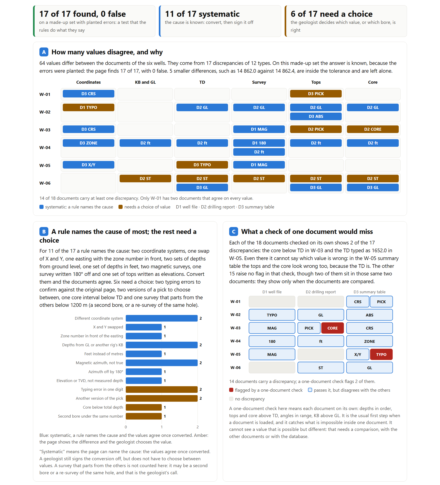

# Какой документ прав?

[English](README.md) · Русский

**Шесть скважин, по три документа на каждую, и значения в них не совпадают. Страница сравнивает их, определяет причину каждого расхождения и выделяет те, где нужно решение геолога.**

Прежде чем данные старых скважин попадут в проектную базу, одно и то же значение приходится сверять в нескольких документах: в деле скважины, в отчёте по бурению, в сводной таблице, составленной годы спустя. Значения расходятся, и у большинства расхождений простая причина: другая система координат, глубины от поверхности земли, футы, магнитный азимут, отбивки в абсолютных отметках. Немногие требуют решения. На пилоте на действующем месторождении я работаю с историческими данными скважин: координатами устьев, инклинометрией, отбивками, керном и делами скважин. Там, по моей оценке, подготовка исторических данных скважин шла примерно в 1,5–2 раза быстрее, чем вручную. ИИ хорошо читает и сравнивает; решение, какой документ прав, остаётся за геологом. Эта страница показывает логику такой сверки на выдуманных документах.

Страница не читает сканы, в ней нет агентов и языковых моделей: значения вводятся руками.

**[Открыть страницу](https://maxim-balaguroff.github.io/how-sure/06-which-document/which-document.html)** · [скачать файл](https://github.com/maxim-balaguroff/how-sure/releases/latest/download/which-document.html) (один HTML-файл, работает без интернета) · одна страница для печати: [PDF](which-document-one-page.ru.pdf). Сама страница на английском.

## Три вывода

**А. Сколько значений расходится и почему.** В выдуманном наборе между документами шести скважин расходятся 64 значения. Они складываются в 17 расхождений 12 типов. Ошибки заложены намеренно, поэтому правильный ответ известен: страница находит 17 из 17, ложных нет. Пять более мелких различий, например 14 862,0 и 14 862,4, находятся в пределах допуска и расхождением не считаются.

**Б. У большинства причину называет правило, остальные решает геолог.** У 11 из 17 причина систематическая: в двух случаях другая система координат, в одном переставлены X и Y, в одном перед восточной координатой стоит номер зоны, в двух глубины от поверхности земли, в одном глубины в футах, в двух магнитные азимуты, в одном азимуты инклинометрии развёрнуты на 180°, в одном отбивки в абсолютных отметках. После пересчёта документы совпадают; пересчёт утверждает геолог. Шесть требуют решения: две опечатки, которые надо сверить с первичным документом (сканом), две версии отбивки, из которых надо выбрать, один интервал керна ниже забоя (неверна либо глубина керна, либо забой) и одна инклинометрия, которая расходится с остальными ниже 1200 м. Это может быть второй ствол под тем же номером или повторный замер того же ствола; в отчёте по бурению этого ствола альтитуда стола ротора на 1,7 м ниже, чем у первого.

**В. Что пропустила бы проверка одного документа.** Проверка каждого из 18 документов по отдельности (глубины по порядку, отбивки и керн выше забоя, зенитные углы и азимуты в допустимых пределах) выявляет только 2 из 17 расхождений: керн ниже забоя и забой, записанный как 1652 вместо 1952. Даже тогда она не говорит, какое значение неверно. Остальные 15 такая проверка не помечает (13 из них в документах, которые её проходят), они выявляются только при сопоставлении документов между собой.

## Типы

Обозначения: KB, альтитуда стола ротора; GL, альтитуда земли; TVD, вертикальная глубина.

| Тип | Класс | Как страница его узнаёт |
|---|---|---|
| Другая система координат | систематическое | после пересчёта точки совпадают |
| X и Y переставлены | систематическое | X одного документа равен Y другого |
| Номер зоны перед восточной координатой | систематическое | северная координата (X) совпадает, а восточная (Y) отличается на целое число миллионов метров (номер зоны, от 1 до 60) |
| Глубины от поверхности земли или от стола ротора другой установки | систематическое | глубины меньше на высоту стола ротора над землёй (KB − GL), или в документе указано GL; или в документе своя альтитуда стола ротора, и глубины отличаются ровно на эту разницу |
| Футы вместо метров | систематическое | глубины × 0,3048 равны глубинам другого документа; альтитуды стола ротора и земли тоже считаются в футах, если после пересчёта совпадают |
| Магнитный азимут вместо истинного | систематическое | азимуты при зенитном угле от 3° отличаются от истинных на склонение (магнитный = истинный − склонение, восточное положительно), или в документе указано, что азимуты магнитные |
| Азимут развёрнут на 180° | систематическое | азимуты при зенитном угле от 3° отличаются на 180°: обратные азимуты или азимуты, отсчитанные от юга |
| Абсолютная отметка или TVD вместо глубины по стволу | систематическое | значение равно KB − TVD, TVD − KB (TVDSS), TVD или отметке, посчитанной от глубины по стволу или от GL |
| Опечатка в одной цифре | решает геолог | отличается одна цифра, переставлены две соседние или одной не хватает; для глубин и координат разница не меньше 10 м |
| Другая версия отбивки | решает геолог | отбивка отличается не больше, чем допускает её уточнение (переинтерпретация), по умолчанию до 15 м |
| Керн ниже забоя | решает геолог | интервал керна лежит ниже согласованного забоя |
| Второй ствол под тем же номером | решает геолог | замеры инклинометрии, сопоставленные по глубине, совпадают в верхней части и расходятся ниже, забои разные (боковой ствол или повторный замер того же ствола) |
| Постоянный сдвиг глубин, точка отсчёта неизвестна | решает геолог | глубины сдвинуты на одну величину, и это не KB − GL |
| Постоянный сдвиг азимутов | решает геолог | азимуты при зенитном угле от 3° сдвинуты на один угол, и это не магнитное склонение (дирекционные углы вместо азимутов, то есть сближение меридианов, или другое значение склонения) |

Правило о глубинах или азимутах выполняется, когда ему отвечают не меньше 80 % сравниваемых значений, и сравнивается не меньше трёх.

Двух последних типов нет в выдуманном наборе; проверки страницы испытывают их на коротких тестовых скважинах, в каждой из которых заложен один тип. Ещё два исхода уходят геологу без правила: системы координат различаются, а параметры перехода не заданы; расхождение, к которому не подходит ни одно правило.

## Как пользоваться

1. Откройте страницу и прочитайте три вывода на выдуманном наборе, затем реестр шести скважин ниже: каждое расхождение со значениями трёх документов, типом, тем, что проверить, и полем для решения. Реестр выгружается в CSV, по строке на значение; принятые значения выгружаются архивом ZIP (ниже).
2. Посмотрите проверки внизу: **ALL 130 PASS**. Они сверены с ручным расчётом, со списком заложенных ошибок и с независимым расчётом ([`sverka_ref.py`](sverka_ref.py)), который своим кодом находит расхождения и определяет принятые значения.
3. Потом внесите свою скважину в разделе «Try your own well»: два или три документа, допуски, склонение и параметры перехода между вашими системами координат.
4. Или вставьте таблицу многих скважин в разделе «Many wells at once», по строке на документ, или откройте её как CSV-файл. Страница читает её в браузере, сводит имена скважин, записанные по-разному (W-04, w04, W 4) или похожими кириллическими и латинскими буквами (С-12 и C-12), и даёт сводку по каждой скважине и один реестр на все. Кнопка «Put the example wells here» показывает формат; столбец `uwi`, если он есть, попадает в выгрузку принятых значений.

Замеры инклинометрии сравниваются по глубине, а не по порядку в списке: если в документе нет замера на этой глубине, значение интерполируется между соседними замерами того же документа, а инклинометрия бокового ствола сравнивается от глубины зарезки (точки привязки к основному стволу) вниз. Где два документа совпадают, они задают опорное значение. Если совпадений нет, за опорный принимается документ с наивысшим приоритетом: указанный пользователем, иначе отчёт по бурению, затем дело скважины, затем сводная таблица. Если расходится как раз этот документ (опечатка, отбивка, керн или расхождение, к которому не подходит ни одно правило), подсказка говорит об этом: сводная, переписанная из дела, повторяет его ошибки и может перевесить первичный документ.

Три главных ограничения: числа выдуманы; значения вводятся руками, из сканов ничего не читается; страница показывает расхождение и его вероятную причину, а какое значение верное, решается по первичным документам. Ещё одно, для выгрузки: если вместо склонения введена полная поправка к сеточному северу, исправленные ею азимуты сеточные, а `AZI_REF` всё равно пишет `TrueNorth`; метку нужно исправить вручную перед загрузкой. Остальные ограничения перечислены на странице.

## Принятые значения для базы или ГИС

У каждого реестра вторая кнопка, «Accepted values, ZIP». Она даёт то, что идёт дальше в проектную базу:

- `wellheads.csv`, `trajectory.csv`, `tops.csv`: простой CSV, UTF-8, одна строка заголовка, запятые, точка в числах, единица в имени каждого столбца с измерением (`KB_M`, `MD_M`, `INC_DEG`). Глубины по стволу от стола ротора опорного документа, азимуты к истинному северу там, где это сказано в `AZI_REF`; в траектории TVD, DX (на восток) и DY (на север) по методу минимальной кривизны от вертикального начала у стола ротора, у отбивок TVD и TVDSS. Файлы связывает столбец `UWI`.
- `wellheads.gpkg`: слой устьев GeoPackage (большинство столбцов `wellheads.csv`), записанный в браузере без библиотек.
- `documents.csv`: документы каждой скважины и их приоритет; `*.csvt`: типы столбцов для QGIS; `osdu-fields.csv`: для каждого столбца поле OSDU или WITSML с версией схемы и ссылкой на файл схемы, «not mapped» (не сопоставлено) или «as in wellheads.csv» (как в wellheads.csv); `README.txt`: как читать и загружать файлы.

Значение каждого поля то, которое принимает сверка: значение, на котором сходятся два документа, по возможности из документа без пересчёта, затем первого по приоритету среди них; если двух совпадающих нет, значение документа, первого по приоритету. Траектория берётся из одного документа целиком, даже на станции, где остальные расходятся с ней большинством; это видно по её статусу. Второй ствол не даёт значения, если оно есть в другом документе; отбивка в абсолютной отметке не берётся никогда. У каждой строки статус: совпадает (agreed), один документ (one document), причину расхождения называет правило (converted), решает геолог (needs a choice) или точка привязки (tie point) у строки траектории на MD 0. Строка ждёт решения (PENDING = yes), пока у каждого расхождения на ней нет решения в реестре; пересчёт тоже утверждается решением. Введённое решение снимает пометку и не меняет значение: если решено взять значение другого документа, его меняют вручную. Отбивка ждёт, пока ждут альтитуда стола ротора или станция инклинометрии, от которых она посчитана. В примере решения ждут 44 строки, решений нет. Инклинометрия, которая может быть вторым стволом, в выгрузку не попадает; после решения геолога её добавляют вручную как отдельный ствол или как повторный замер.

Все устья приводятся к одной системе, той, в которой большинство скважин; устье без параметров перехода к ней сохраняет свои значения, говорит об этом и не попадает в слой GeoPackage. Координаты названы по смыслу, `NORTHING_M` и `EASTING_M` (X и Y страницы), чтобы ГИС взяла `EASTING_M` как x. Система, записанная как `EPSG:код`, или с «(EPSG:код)» в имени, или с кодом в форме, получает этот код. У одной проекции два кода, когда номер зоны стоит перед восточной координатой и когда его нет: 28408 и 2498 для Pulkovo 1942 / Gauss-Kruger zone 8, 4647 и 25832 для ETRS89 / UTM zone 32N; для этих четырёх кодов файл говорит, когда восточная координата и код не сходятся. Коды и их определения сверены на epsg.io (EPSG Dataset 13.102); для известных странице кодов GeoPackage несёт определение системы. Текст WKT пяти проекционных определений и числа TOWGS84 взяты с epsg.io и не повторяют набор EPSG дословно. Владелец набора EPSG (EPSG Dataset) IOGP (International Association of Oil & Gas Producers), [условия использования](https://epsg.org/terms-of-use.html). Лицензия CC BY 4.0 внизу на них не распространяется. У выдуманных систем примера кода нет.

Что проверено, на выдуманном примере и на таблице открытых данных Sodir FactPages (три ствола одной скважины и их общий участок, ED50 / UTM zone 31N, EPSG 23031):

- страница сверяет выгрузку выдуманного примера с `sverka_ref.py`, значение за значением и статус за статусом; скрипт сборки (ниже) делает то же для обоих наборов;
- отдельный скрипт сборки (его нет в этой папке) читает обратно каждый записанный страницей файл: ZIP и его контрольные суммы, каждый CSV по его `.csvt`, те же ячейки, что держала страница, и GeoPackage по стандарту GeoPackage 1.3 (три его таблицы и их столбцы, строки систем, байты точек) с проверкой целостности SQLite;
- каждое свойство и каждый код OSDU в `osdu-fields.csv` прочитаны 22–24 ноября 2026 года в файлах схем репозитория OSDU data-definitions через его API, версия указана; ни одной записи в платформу OSDU не загружалось.

В GDAL, QGIS и ArcGIS образцы GeoPackage не открывались. Шаги загрузки в QGIS и ArcGIS Pro в `README.txt` взяты из их открытой документации. Petrel, Kingdom и DecisionSpace с окном импорта программы не сверялись (в `README.txt`: «not checked against the vendor's import window»), потому что документация импорта этих программ закрыта; `README.txt` цитирует то немногое, что говорят открытые источники, а столбцы там сопоставляются вручную.

## Как это связано с другими инструментами

- **Инструмент 01** разбирает прошлые прогнозы. Его таблица надёжна ровно настолько, насколько надёжны данные скважин под ней: глубины, отбивки и координаты сначала проверяются здесь.
- **Инструмент 03** планирует мелкие скважины с керном. Их интервалы керна и отбивки и есть те самые значения, которые потом оказываются в трёх документах с тремя разными числами.

## Файлы

| Файл | Что это |
|---|---|
| [`which-document.html`](which-document.html) | Страница: один файл, интернет не нужен, данные не покидают браузер |
| [`which-document-one-page.ru.pdf`](which-document-one-page.ru.pdf) · [`.pdf`](which-document-one-page.pdf) | Одна страница для печати и обсуждения, на русском и английском |
| [`sverka_ref.py`](sverka_ref.py) | Независимая проверка, на которой стоят проверки страницы (Python, numpy) |
| [`example.json`](example.json) | Выдуманный набор: шесть скважин, по три документа |
| [`answer_key.json`](answer_key.json) | Заложенные расхождения, ответ, с которым сверяются проверки |
| [`example_clean.json`](example_clean.json) | Тот же набор без заложенных ошибок |
| `screenshot-page.png` | Страница на выдуманном наборе |
| `cover.png` | Картинка, которая показывается, когда страницей делятся по ссылке |

Сделано с помощью ИИ; геология и проверки мои.

Лицензия: [CC BY 4.0](../LICENSE). Максим Балагуров, геолог-нефтяник · v1.6 · DOI [10.5281/zenodo.24242389](https://doi.org/10.5281/zenodo.24242389)
