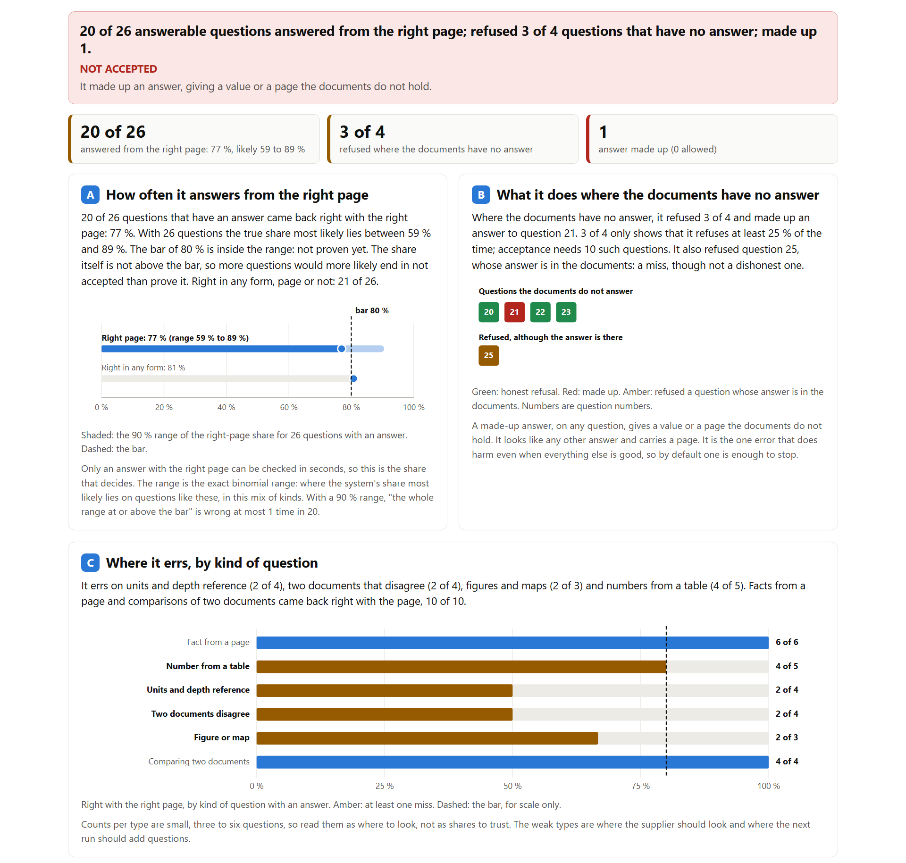

# Is the answer on the page it cites?

English · [Русский](README.ru.md)

**An acceptance check for a system that searches your documents and answers questions with a page reference: about forty questions, one grade per answer, and the result in one line.**

Such systems are easy to show and hard to check. An answer that carries a page looks equally convincing whether it came from that page or not. This tool turns "it seems to work" into a count a geologist can make in one day: how often the answer came from the right page, what the system does where the documents have no answer, and which kinds of question it gets wrong. It does no searching itself and names no product. It works with any system that gives an answer and the page it took it from.

I set the geological task and check the result. I design the workflow scenarios, the behaviour of the AI models and the graphics. I work closely with IT developers, some of them with oil-company experience.

The page works on a made-up run: 30 questions about six made-up reports on two made-up wells. It opens on the verdict and three findings; the form to grade your own run is below them. The same calculation is in a spreadsheet.

**[Open the page](https://maxim-balaguroff.github.io/how-sure/07-library-acceptance/library-acceptance.html)** · [download the file](https://github.com/maxim-balaguroff/how-sure/releases/latest/download/library-acceptance.html) (one HTML file, works offline) · the spreadsheet: [Excel](https://github.com/maxim-balaguroff/how-sure/raw/main/07-library-acceptance/library-acceptance.xlsx) · one page: [PDF](library-acceptance-one-page.pdf)

## The made-up run in one line

> 20 of 26 answerable questions answered from the right page; refused 3 of 4 questions that have no answer; made up 1.

Verdict: **not accepted**. One answer was made up: a recovery factor, with a page that does not hold it.

## Three findings

**A. How often it answers from the right page.** 20 of 26: 77 %. With 26 questions the system's share on questions like these most likely lies between 59 and 89 %. The bar of 80 % is inside that range, so the share is not proven; and since the share itself is below the bar, more questions would more likely end in "not accepted" than prove it. Right in any form, with or without the page, 21 of 26.

**B. What it does where the documents have no answer.** It refused 3 of 4 and made up the fourth. One made-up answer is enough to stop: it looks like any other answer and carries a page. Four refusals of four would still only show that it refuses at least about half the time, which is why acceptance needs at least ten such questions.

**C. Where it errs.** Units and depth reference 2 of 4, two documents that disagree 2 of 4, figures 2 of 3, numbers from a table 4 of 5. Facts and comparisons came back right with the page, 10 of 10. The weak kinds are where the supplier should look and where the next run should add questions.

## The rule

- **Accepted** only if the whole range of the right-page share is at or above the bar (80 % by default), no answer was made up, and the run held at least 10 questions with no answer. With 30 questions with an answer that takes 28 right.
- **Not accepted** if an answer was made up, or the whole range is below the bar.
- **Not proven yet** otherwise. The page says how many more questions would settle it, if the share held.

All four settings can be changed on the page and in the spreadsheet; agree them with the supplier in writing before the run. A system that is truly right nine times in ten passes a run of 30 questions with an answer only about four times in ten, and steadily eight times in ten only from about 95. The rest read "not proven yet", which is honest.

## Using it

1. Open the page and read the verdict and the three findings on the example.
2. Look at the checks at the bottom: **ALL 112 PASS**, against answers worked out by hand and an independent calculation ([`acceptance_ref.py`](acceptance_ref.py)).
3. Plan your own run: about 40 questions of seven kinds, 30 with an answer and 10 without, written before the system sees them. The page lists how to spend the day.
4. Enter the type and grade of each answer in the form, or paste them as CSV. Or work in the spreadsheet: the Test sheet reads **ALL 38 PASS** while the example is in place. No macros.

The limits that matter most: the run is made up; the check says nothing about speed, access rights, security or text recognition on scans; and the share describes the system on this kind of question set, not on every question. The page lists the rest.

## Files

| File | What it is |
|---|---|
| [`library-acceptance.html`](library-acceptance.html) | The page: one file, no internet needed, no data leaves the browser |
| [`library-acceptance.xlsx`](library-acceptance.xlsx) | The same calculation as a spreadsheet: Questions, Scoring, Result, Test; no macros |
| [`library-acceptance-one-page.pdf`](library-acceptance-one-page.pdf) | One page: how to accept a document search in one day, the example, the rule, the limits ([Russian](library-acceptance-one-page.ru.pdf)) |
| [`acceptance_ref.py`](acceptance_ref.py) | The independent calculation behind the checks (Python, scipy) |
| [`questions.json`](questions.json) | The made-up run: the library, the 30 questions, the answers and the grades, which the calculation reads |
| `screenshot-page.png` | The page on its example |
| `cover.png` | The picture shown when the page is shared as a link |

Built with AI assistance; the method and the checks are mine.

Licence: [CC BY 4.0](../LICENSE). Maxim Balagurov, petroleum geologist · v1.6 · DOI [10.5281/zenodo.24242389](https://doi.org/10.5281/zenodo.24242389)
