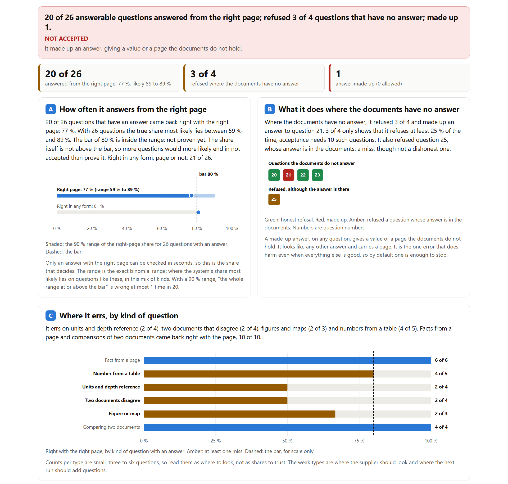

# Есть ли ответ на указанной странице?

[English](README.md) · Русский

**Приёмочная проверка системы, которая ищет по вашим документам и отвечает на вопросы со ссылкой на страницу: около сорока вопросов, одна оценка на ответ и итог одной строкой.**

Такие системы легко показать и трудно проверить. Ответ со ссылкой на страницу выглядит одинаково убедительно, взят он с этой страницы или нет. Инструмент превращает «вроде работает» в счёт, который геолог делает за один день: как часто ответ взят с верной страницы, что система делает там, где в документах ответа нет, и на каких видах вопросов она ошибается. Сам он ничего не ищет и ни один продукт не называет. Работает с любой системой, которая даёт ответ и страницу, с которой его взяла.

В таких продуктах я ставлю геологическую задачу и проверяю результат, выстраиваю рабочие сценарии, поведение моделей ИИ и графику. I work closely with IT developers, some of them with oil-company experience.

Страница работает на выдуманном прогоне: 30 вопросов по шести выдуманным отчётам о двух выдуманных скважинах. Она открывается решением и тремя выводами; форма для оценки своего прогона стоит ниже. Тот же расчёт есть в книге Excel. Страница и книга на английском.

**[Открыть страницу](https://maxim-balaguroff.github.io/how-sure/07-library-acceptance/library-acceptance.html)** · [скачать файл](https://github.com/maxim-balaguroff/how-sure/releases/latest/download/library-acceptance.html) (один HTML-файл, работает без интернета) · книга: [Excel](https://github.com/maxim-balaguroff/how-sure/raw/main/07-library-acceptance/library-acceptance.xlsx) · одна страница: [PDF](library-acceptance-one-page.ru.pdf)

## Выдуманный прогон одной строкой

> 20 of 26 answerable questions answered from the right page; refused 3 of 4 questions that have no answer; made up 1.

Решение: **не принято**. Один ответ выдуман: коэффициент извлечения со ссылкой на страницу, где его нет.

## Три вывода

**А. Как часто ответ с верной страницей.** 20 из 26: 77 %. При 26 вопросах доля системы на таких вопросах вероятно лежит от 59 до 89 %. Планка 80 % внутри диапазона, так что доля не доказана; а раз сама доля ниже планки, новые вопросы скорее приведут к «не принято», чем докажут её. Верных в любом виде, со страницей и без, 21 из 26.

**Б. Что делает там, где ответа нет.** Отказалась в 3 случаях из 4, в четвёртом выдумала. Одной выдумки достаточно, чтобы остановиться: она выглядит как любой ответ и несёт ссылку на страницу. Даже 4 отказа из 4 показали бы только, что система отказывается хотя бы примерно в половине случаев, поэтому для приёмки нужно не меньше десяти таких вопросов.

**В. Где ошибается.** Единицы и точка отсчёта глубины 2 из 4, расходящиеся документы 2 из 4, рисунки 2 из 3, числа из таблиц 4 из 5. Факты и сравнения верны и со страницей, 10 из 10. Слабые виды показывают, куда смотреть поставщику и куда добавить вопросов при повторной проверке.

## Правило

- **Принято**, только если весь диапазон доли ответов с верной страницей не ниже планки (по умолчанию 80 %), нет выдумок и в прогоне не меньше 10 вопросов без ответа. При 30 вопросах с ответом для этого нужно 28 верных.
- **Не принято**, если есть выдумка или весь диапазон ниже планки.
- **Не доказано** в остальных случаях. Страница считает, сколько вопросов добавить, если доля останется той же.

Все четыре настройки меняются на странице и в книге; согласуйте их с поставщиком письменно до прогона. Система, которая на деле права в девяти случаях из десяти, проходит прогон из 30 вопросов с ответом лишь примерно в четырёх случаях из десяти, а устойчиво в восьми из десяти только примерно с 95 вопросов. Остальные прогоны дают «не доказано», и это честно.

## Как пользоваться

1. Открыть страницу и прочитать решение и три вывода на примере.
2. Посмотреть проверки внизу: **ALL 112 PASS**, против ручного счёта и независимого расчёта ([`acceptance_ref.py`](acceptance_ref.py)).
3. Спланировать свой прогон: около 40 вопросов семи видов, 30 с ответом и 10 без ответа, написанных до того, как их увидит система. Как распределить день, написано на странице.
4. Внести вид и оценку каждого ответа в форму или вставить их как CSV. Или работать в книге: лист Test показывает **ALL 38 PASS**, пока в ней пример. Макросов нет.

Главные границы: прогон выдуман; проверка ничего не говорит о скорости, правах доступа, безопасности и распознавании сканов; доля описывает систему на таком наборе вопросов, а не на любых вопросах. Остальное перечислено на странице.

## Файлы

| Файл | Что это |
|---|---|
| [`library-acceptance.html`](library-acceptance.html) | Страница: один файл, без интернета, данные не покидают браузер |
| [`library-acceptance.xlsx`](library-acceptance.xlsx) | Тот же расчёт в книге: Questions, Scoring, Result, Test; без макросов |
| [`library-acceptance-one-page.ru.pdf`](library-acceptance-one-page.ru.pdf) | Одна страница: как за один день принять поиск по документам, пример, правило, границы ([английская](library-acceptance-one-page.pdf)) |
| [`acceptance_ref.py`](acceptance_ref.py) | Независимый расчёт для проверок (Python, scipy) |
| [`questions.json`](questions.json) | Выдуманный прогон: библиотека, 30 вопросов, ответы и оценки; их читает расчёт |
| `screenshot-page.png` | Страница на примере |
| `cover.png` | Картинка, которую показывают, когда страницей делятся ссылкой |

Сделано с помощью ИИ; метод и проверки мои.

Лицензия: [CC BY 4.0](../LICENSE). Максим Балагуров, геолог-нефтяник · v1.6 · DOI [10.5281/zenodo.24242389](https://doi.org/10.5281/zenodo.24242389)
