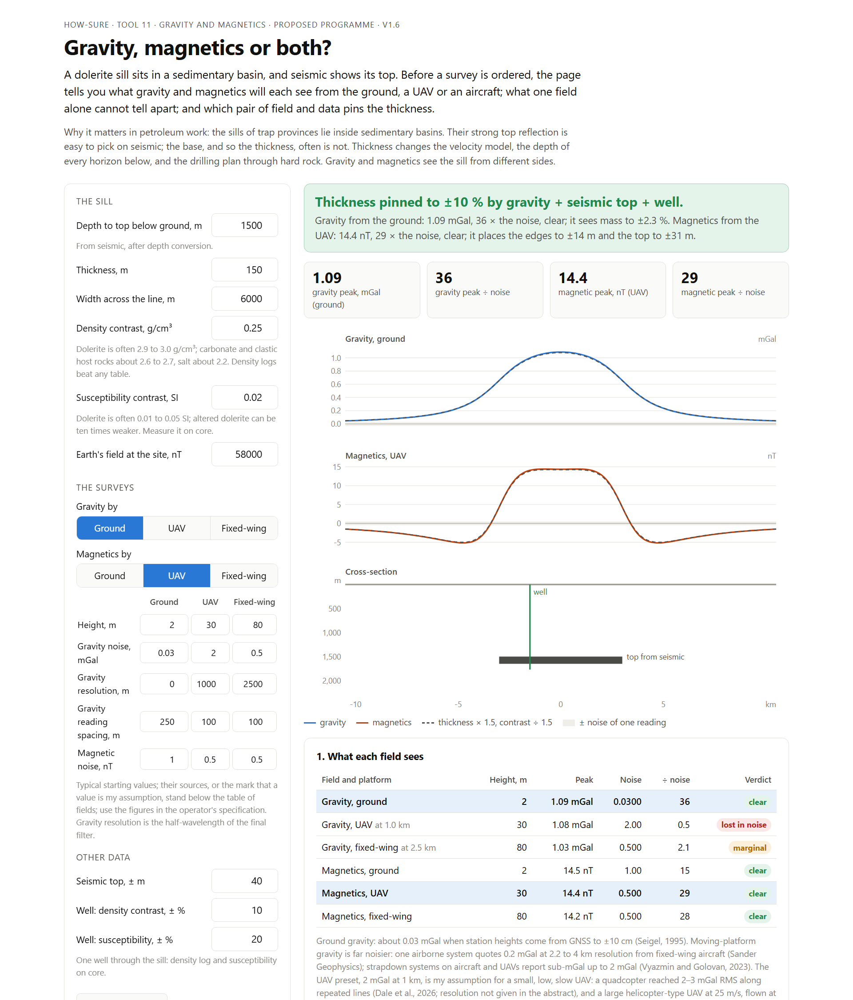

# Gravity, magnetics or both?

English · [Русский](README.ru.md)

**A check for one geological question before a gravity or magnetic survey is ordered: what will each field tell about a sill whose top is known from seismic?**

For geologists who work with sills of trap provinces inside sedimentary basins. Describe the sill and the surveys you have in mind; the page tells you what gravity and magnetics will each see from the ground, a UAV or an aircraft, what one field alone cannot tell apart, and which pair of field and data pins the thickness.

Why it matters in petroleum work: the strong top reflection of a dolerite sill is easy to pick on seismic; the base, and so the thickness, often is not. Thickness changes the velocity model, the depth of every horizon below, and the drilling plan through hard rock.

**[Open the page](https://maxim-balaguroff.github.io/how-sure/11-gravity-or-magnetics/gravity-or-magnetics.html)** · [download the file](https://github.com/maxim-balaguroff/how-sure/releases/latest/download/gravity-or-magnetics.html) (one HTML file, works offline in any browser) · one page to print: [EN](gravity-or-magnetics-one-page.pdf) · [RU](gravity-or-magnetics-one-page.ru.pdf)

Stage: proposed programme. The page plans; it reports no survey.

## What it tells you

1. **What each field sees.** The gravity and magnetic peaks against the noise of one reading, for ground, UAV and fixed-wing surveys side by side. Gravity from a moving platform is far noisier than on the ground, and the table shows by how much; each noise figure has its source or is marked as my assumption.
2. **What one field alone cannot tell apart.** Gravity measures mass per area, density contrast × thickness: a thicker, lighter sill gives the same profile. Magnetics measures susceptibility × thickness, but the width of its edge anomaly carries the depth to the top and the position of the edges.
3. **Which pair pins it.** For seven sets of data (gravity, magnetics, seismic top, a well, and their combinations), how far the top, the edges, the mass and the thickness can still move after the data.

Magnetics on its own, with line spacing, sensor height and two bodies side by side, is [tool 02](../02-magnetic-survey-check/).

## The example (made up)

A dolerite sill in carbonates and salt above a clastic section. Top 1,500 m below ground from seismic (±40 m), 150 m thick, 6 km across the line. Density contrast 0.25 g/cm³, susceptibility contrast 0.02 SI, Earth's field 58,000 nT. Gravity from the ground, magnetics from a UAV at 30 m. One well through the sill gives the density (±10 %) and the susceptibility (±20 %).

- **Gravity:** 1.09 mGal over the middle of the sill. On the ground that is 36 times the noise of 0.03 mGal: clear. From a fixed-wing aircraft at 2.5 km resolution, 1.03 mGal against 0.5 mGal: marginal. From a small UAV, 1.08 mGal against 2 mGal: lost in noise.
- **Magnetics:** 14.4 nT from the UAV, 29 times the noise of 0.5 nT: clear from every platform.
- **One field alone:** a sill 225 m thick with a contrast of 0.167 g/cm³ differs from the example by 0.0097 mGal, a third of the ground noise: the same gravity data. Magnetics cannot split susceptibility from thickness either (0.27 nT difference), but a top 300 m deeper changes the magnetic edge anomaly by 1.43 nT, 2.9 times the noise.
- **The pair:** gravity alone fixes the mass to ±2.3 % and the thickness only to ±35 %. The seismic top moves the top from ±59 m to ±33 m but leaves the thickness at ±33 %. The density from the well pins the thickness to ±10 %. Magnetics with the core susceptibility gives ±19 %, and it places the edges to ±14 m against ±59 m from gravity. Everything together: ±8.8 %.

Switch gravity to the UAV and no set of data pins the thickness: the best is ±17 % with everything together, and almost all of it comes from magnetics and the well (±19 % without gravity).

## How it works

The sill is a horizontal slab, long along strike, with a flat top and base. Gravity is the closed form for a 2D rectangle (Blakely, 1995); over the middle of a wide sill it tends to the Bouguer slab, 0.042 mGal per metre of sill per g/cm³ of contrast. Magnetics uses the same slab in a vertical field with induced magnetisation, as in tool 02: k F / 2π times the angle the top subtends at the sensor minus the angle the base subtends. Gravity from a moving platform is smoothed with a Gaussian filter that keeps half the amplitude at twice the resolution length.

"Which pair pins it" is a linearised least-squares analysis. Six unknowns (top, thickness, density contrast, susceptibility contrast, two edges), the readings with their noise, and what a geologist would assume before the data: top ±25 % of its depth; thickness, density contrast and susceptibility ±50 %; edges ±1 km. Seismic replaces the starting top with its own ± m; a well replaces the density contrast and the susceptibility with its own ± %. The well's top and thickness hold only at the well, so they are not carried across the sill.

Rules: peak at least 5 × the noise of one reading is clear, 2 to 5 × marginal, under 2 × lost. Two sills whose profiles differ by less than 2 × the noise of one reading are the same data on one reading. Thickness to ±15 % (one standard deviation) is pinned, to ±30 % loose. Gravity readings count once per reading spacing or resolution length, whichever is longer; magnetic readings once per 100 m. These are my conventions.

Noise presets and their sources. Gravity resolution is the half-wavelength of the final filter.

| Platform | Gravity | Magnetics |
|---|---|---|
| Ground, 2 m | 0.03 mGal, stations 250 m apart. About 0.03 mGal when station heights come from GNSS to ±10 cm (Seigel, 1995) | 1 nT, as in tool 02: assumption, not from a source |
| UAV, 30 m | 2 mGal at 1 km resolution: my assumption for a small, low, slow UAV. A quadcopter reached 2–3 mGal RMS along repeated lines (Dale et al., 2026; resolution not given in the abstract); a large helicopter-type UAV at 25 m/s, flown at 340–420 m above the ellipsoid, gave a repeat-line scatter of 0.61 mGal at 1.25 km half-wavelength resolution (Vyazmin and Golovan, 2023) | 0.5 nT: assumption, not from a source. For comparison: a noise envelope of about ±0.05 nT in one fixed-wing UAV survey (reviewed by Zheng et al., 2021), and noise limits of < 1 to < 10 nT set in earlier UAV studies (listed by Tuck et al., 2021) |
| Fixed-wing, 80 m | 0.5 mGal at 2.5 km resolution. One airborne system quotes 0.2 mGal at 2.2 to 4 km from fixed-wing aircraft (Sander Geophysics, AIRGrav); strapdown systems sub-mGal to 2 mGal (Vyazmin and Golovan, 2023) | 0.5 nT: assumption, not from a source |

The presets are typical starting values, not a record of surveys flown. In a project, the geologist sets the geological question and interprets the data; a licensed operator designs and runs the survey.

## Where the question comes up on the Arabian Plate

In the United Arab Emirates the basement is "not imaged by seismic data anywhere within the UAE"; regional gravity and aeromagnetic data put it from 5 km to more than 15 km deep, and most UAE oilfields lie within basement highs (Ali et al., 2017). Offshore Abu Dhabi, the gravity inversion alone "does not delineate very well the basement morphology"; a constrained 3D inversion of gravity and magnetics puts the magnetic basement at 8 to 10 km and the top of the Hormuz salt at 5.5 to 8.5 km (Geng et al., 2020). That study shows the question this page asks: where one field cannot separate two bodies, a second field with constraints may. In Saudi Arabia, Saudi Aramco geoscientists published an "integrated quantitative analysis" of gravity and magnetic data, seismic images and well data for the basement along the Red Sea coast, with seismic constraining the geometry where it is well imaged (Dosari and Ion, 2023). Other Saudi Aramco geoscientists integrated seismic interpretation of the Rub' al-Khali Basin "with regional gravity and magnetic data" (Stewart, Hofmann and Kharouf, 2015). The page assumes a vertical magnetic field; at the latitudes of the Arabian Plate the field is inclined, so its magnetic numbers there are a guide only.

## Checked against known answers

The page carries 38 checks and shows the result at the bottom: **ALL 38 PASS** (checked in Microsoft Edge). Each check compares the page with an answer worked out another way:

- **by hand**, from textbook relations: the Bouguer slab, half the slab over the edge of a half-plane sill, the thin-sheet limits for gravity and magnetics, the magnetic extreme at √(h(h + t)), a filter that keeps half the amplitude at twice its length, and the spreads the analysis must give when the data fix only the mass (35.4 %, 9.8 % with the well density, 18.6 % with the well susceptibility);
- **by an independent calculation** ([`physics_ref.py`](physics_ref.py)): it sums 2D line masses and line dipoles over the sill instead of using the closed forms, smooths with Gauss-Hermite quadrature instead of the page's sampled filter, and builds its own Jacobian with other step sizes. It shares the model and the rules, not the code. Run `python physics_ref.py`: it prints each value against the page and ends with **ALL 23 PASS**.

Change the code and break a formula, and a row turns FAIL.

## Limits

- A 2D sill with flat top and base, uniform rock, flat ground. Real sills step between levels, thin out and have feeders; the page shows the trade-offs, not a model of a real sill.
- Vertical field and induced magnetisation only, which suits high magnetic latitudes. Dolerites often carry strong remanence, which can change the sign of the magnetic anomaly.
- The magnetic noise is instrument and survey noise only. In trap provinces, shallow lavas, tuffs and other sills add geological magnetic noise, which can be much larger. The UAV itself makes interference near the sensor, with peaks of 21.4 to 574.2 nT on four mapped UAVs (Tuck et al., 2021); the sensor is moved away from it or the interference is compensated.
- The regional field and other density contrasts (salt, basement) are not modelled. The noise figures do not include the error of separating the sill from the regional trend; in a real survey that error adds to the noise.
- Noise is independent between readings; levelling errors and other correlated noise make things worse.
- Linearised: the spreads hold for small changes around the sill you describe. A real design and inversion run in 3D with all wells and horizons. The page frames the question; it does not replace the operator's design.

## Files

| File | What it is |
|---|---|
| [`gravity-or-magnetics.html`](gravity-or-magnetics.html) | The page: one file, no internet needed, no data leaves the browser |
| [`gravity-or-magnetics-one-page.pdf`](gravity-or-magnetics-one-page.pdf) | One page to print, English |
| [`gravity-or-magnetics-one-page.ru.pdf`](gravity-or-magnetics-one-page.ru.pdf) | One page to print, Russian |
| [`physics_ref.py`](physics_ref.py) | Independent sums behind the checks (Python, numpy) |
| `screenshot-page.png` | The page on its example |

The check builds on the author's experience integrating potential-field and field data in Arctic and East Siberian regional projects; UAV acquisition is the proposed extension.

References: Blakely, R. J. (1995). *Potential Theory in Gravity and Magnetic Applications*. Cambridge University Press. Seigel, H. O. (1995). *A Guide to High Precision Land Gravimeter Surveys*. Scintrex. Sander Geophysics. AIRGrav airborne gravity, [sgl.com/gravity.html](https://www.sgl.com/gravity.html). Vyazmin, V. S., Golovan, A. A. (2023). Strapdown airborne gravimetry based on aircrafts and UAVs: postprocessing algorithms and new results. *IAG Symposia* 156. [doi:10.1007/1345_2023_219](https://doi.org/10.1007/1345_2023_219). Dale, B., Becker, D., Enzlberger Jensen, T., Forsberg, R. (2026). *IAG Symposia* 158 (GGHS 2024), open access. [doi:10.1007/1345_2025_303](https://doi.org/10.1007/1345_2025_303). Zheng, Li, Xing, Zhang (2021). Unmanned aerial vehicles for magnetic surveys: a review on platform selection and interference suppression. MDPI, 5(3), 93, open access. [mdpi.com/2504-446X/5/3/93](https://www.mdpi.com/2504-446X/5/3/93). Tuck, L. E., Samson, C., Laliberté, J., Cunningham, M. (2021). Magnetic interference mapping of four types of unmanned aircraft systems intended for aeromagnetic surveying. *Geoscientific Instrumentation, Methods and Data Systems*, 10, 101–112. [doi:10.5194/gi-10-101-2021](https://doi.org/10.5194/gi-10-101-2021). Ali, M. Y., Fairhead, Green, Noufal (2017). Basement structure of the United Arab Emirates derived from an analysis of regional gravity and aeromagnetic database. *Tectonophysics*, 712–713, 503–522. [doi:10.1016/j.tecto.2017.06.006](https://doi.org/10.1016/j.tecto.2017.06.006). Geng, Ali, Fairhead, Bouzidi, Barkat (2020). Morphology of the basement and Hormuz salt distribution in offshore Abu Dhabi from constrained 3-D inversion of gravity and magnetic data. *Tectonophysics*, 791, 228563. [doi:10.1016/j.tecto.2020.228563](https://doi.org/10.1016/j.tecto.2020.228563). Dosari and Ion (2023). Basement architecture within coastal area of the Red Sea, Saudi Arabia. *Search and Discovery* 91204. Stewart, Hofmann, Kharouf (2015). Structural evolution of the Rub' Al-Khali Basin, Saudi Arabia. ICE 2015, *Search and Discovery* 90217.

Built with AI assistance; the geology and the checks are mine.

Licence: [CC BY 4.0](../LICENSE). Maxim Balagurov, petroleum geologist · v1.6 · DOI [10.5281/zenodo.24242389](https://doi.org/10.5281/zenodo.24242389)
