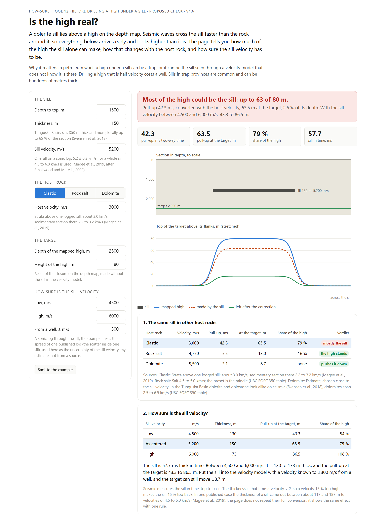

# Is the high real?

English · [Русский](README.ru.md)

**A check before drilling a high that lies under a dolerite sill: how much of the high can the sill alone make by pulling the seismic time up?**

For geologists who map structures under sills of trap provinces in sedimentary basins. Describe the sill, the host rock and the high on your depth map; the page tells you how large the pull-up is at the target, what share of the high it can explain, how that changes if the host is salt or dolomite instead of a clastic section, and how sure the sill velocity has to be.

Why it matters in petroleum work: seismic waves cross a fast sill sooner than the rock around it, so everything below arrives early and looks higher. A depth map made with a velocity model that does not hold the sill shows a high that may be partly or wholly the sill. Drilling a high that is half velocity costs a well.

**[Open the page](https://maxim-balaguroff.github.io/how-sure/12-is-the-high-real/is-the-high-real.html)** · [download the file](https://github.com/maxim-balaguroff/how-sure/releases/latest/download/is-the-high-real.html) (one HTML file, works offline in any browser) · one page to print: [EN](is-the-high-real-one-page.pdf) · [RU](is-the-high-real-one-page.ru.pdf)

Stage: proposed check. The example is made up and reports no project.

## What it tells you

1. **How big the pull-up is.** In milliseconds of two-way time, and in metres at the target once time is converted to depth with the host velocity, the usual case when the sill is not in the velocity model.
2. **What share of the high it can be.** The pull-up against the height of the high you mapped, with a verdict: at least half of the high could be the sill (red), a fifth to a half (amber), under a fifth (green). A sill slower than its host pushes the horizon below it down and makes no pull-up; the flanks beside it can then look relatively high, and the page does not judge them.
3. **How the host rock changes it.** The same sill in a clastic section, in rock salt and in dolomite, side by side. A dolerite sill in fast dolomite or salt makes little or no pull-up.
4. **How sure the sill velocity has to be.** Seismic measures the sill in time. Read with a velocity 15 % too high, the sill comes out 15 % too thick, and the estimated pull-up changes by more: about 35 % in the example. A well with a sonic log narrows the velocity; the page shows what is left at the target.

Whether gravity or magnetics can constrain the sill, its thickness and its edges is [tool 11](../11-gravity-or-magnetics/).

## The example (made up)

A dolerite sill, top 1,500 m, 150 m thick, 5,200 m/s, in a clastic section at 3,000 m/s. A high 80 m in relief on the depth map at 2,500 m, mapped without the sill in the velocity model. The sill velocity is known to lie between 4,500 and 6,000 m/s; a well would narrow it to about ±300 m/s (my estimate; see the sources below).

- **Pull-up:** 42.3 ms of two-way time; converted with the host velocity, 63.5 m at the target, 2.5 % of its depth.
- **Share of the high:** 79 %. Most of the high could be the sill.
- **Host rock:** in rock salt at 4,750 m/s the same sill makes 5.5 ms and 13.0 m (16 % of the high, the high stands). In dolomite at 5,500 m/s it is slower than its host and pushes the horizon down by 8.7 m.
- **Sill velocity:** the sill is 57.7 ms thick in time. Between 4,500 and 6,000 m/s it is 130 to 173 m thick and the pull-up is 43.3 to 86.5 m: 54 % to 108 % of the high. With the sill in the velocity model at a velocity known to ±300 m/s, the target can still move ±8.7 m.

## How it works

Rays go straight down through flat layers. Across a sill of thickness t the wave spends 2t / Vs instead of 2t / Vh, so everything below arrives earlier by

ΔT = 2t (1 / Vh − 1 / Vs).

Converted to depth with the host velocity, as when the velocity model does not hold the sill, the target comes out higher by

Δz = ΔT · Vh / 2 = t (1 − Vh / Vs).

The overburden above the sill cancels: it is the same with and without the sill, so the page does not ask for it. Seismic gives the sill in time, τ = 2t / Vs. Read with another velocity V, its thickness becomes τV / 2 and the estimated pull-up (τ / 2)(V − Vh). With the sill in the velocity model at a velocity off by δV, the target moves by (τ / 2) δV.

Rules: the share of the high is Δz divided by the height of the high. At least 50 % is red, 20 to 50 % amber, under 20 % green. These thresholds are my conventions.

## Numbers and their sources

Every number on the page comes from an open source checked on its page, or is marked as my own choice.

| Number on the page | Source | Status |
|---|---|---|
| Sill velocity 5,200 m/s; ±300 m/s for a well | One sill on a sonic log: average interval velocity 5.2 km/s, standard deviation 0.3 km/s (Magee et al., 2019). That is the scatter of sonic values inside one sill; the page uses it as the uncertainty of the sill velocity once a well is tied; away from the well the velocity can change more | checked on the open page; its use as the uncertainty of the mean velocity is an estimate, not from a source |
| Sill velocity range 4,500 to 6,000 m/s | Used for a whole sill by Magee et al. (2019), after Smallwood and Maresh (2002) | checked on the open page (Magee); Smallwood and Maresh as cited |
| Thickness 117 to 187 m for 4.5 to 6.0 km/s | Magee et al. (2019), their full conversion. The page does not repeat it; it shows the same effect with τV / 2 (130 to 173 m on its example) | checked on the open page |
| Clastic host 3,000 m/s | About 3.0 km/s in the strata above the logged sill; 2.2 to 3.2 km/s in that section (Magee et al., 2019) | checked on the open page |
| Rock salt host 4,750 m/s | The middle of 4.5 to 5.0 km/s for salt (UBC EOSC 350 table of rough ranges) | checked on the open page; the middle is my choice |
| Dolomite host 5,500 m/s | Estimate, chosen close to the sill velocity: Svensen et al. 2018 note that dolerite and dolomite look alike on seismic; the range for dolomites is 2.5–6.5 km/s (UBC) | range checked; the value is an estimate, not from a source |
| Sill thickness 150 m; sills 350 m and more | Tunguska Basin: sills 350 m thick and more, locally up to 65 % of the section (Svensen et al., 2018) | checked on the open page; 150 m is my example |
| Dolerite and dolostone look alike on seismic | Svensen et al. (2018) | checked on the open page |
| Share of the high and the 50 % and 20 % thresholds | My conventions | estimate, not from a source |

## Where the question comes up on the Arabian Plate

For near-surface velocities, Saudi Aramco geoscientists published "a novel 3D simultaneous joint inversion scheme for gravity and seismic travel-time data" (Colombo, Rovetta and Sandoval Curiel, 2014). An earlier study of the south Rub' al-Khali, with co-authors from two other organisations, wrote that integrating seismic with non-seismic data (gravity, EM) "can solve the shallow velocity modeling problem" (Colombo et al., 2010). Those studies deal with the near surface. This page asks a velocity question about a sill deeper in the section; tool 11 asks what gravity and magnetics can tell about that sill.

## Checked against known answers

The page carries 26 checks and shows the result at the bottom: **ALL 26 PASS** (checked in Microsoft Edge). Each check compares the page with an answer worked out another way:

- **by hand**, from the relations above: the example pull-up, no pull-up when the sill is as fast as its host, a push-down when it is slower, a pull-up that tends to the thickness for a very fast sill, twice the thickness for twice the pull-up, the thickness from its own time at its own velocity, 15 % on the velocity for 15 % on the thickness, the share and the verdict thresholds;
- **by an independent calculation** ([`physics_ref.py`](physics_ref.py)): it builds a velocity log on a 1 cm grid, with a slow overburden the page does not have, adds up two-way time cell by cell, converts time back to depth by bisection, and finds the thickness from time by bisection instead of τV / 2. It shares the model, not the code. Run `python physics_ref.py`: it prints each value against the page and ends with **ALL 14 PASS**.

Change the code and break a formula, and a row turns FAIL.

## Limits

- Straight vertical rays and flat layers. Under a sill narrower than the seismic Fresnel zone the pull-up is smeared and smaller, and at the sill edges ray bending distorts the image. The page gives the full pull-up under the middle of a wide sill; a narrower sill and the smoothing of seismic imaging give less.
- A sill of even thickness under the whole map lifts everything below it by the same amount and makes no high. The pull-up becomes relief only where the sill lies under the crest and is thinner, slower or absent under the flanks. The page compares the full pull-up with the height of the high, so it takes the case of no sill under the flanks.
- Velocity models from stacking velocities or tomography often hold part of the sill, smeared over a thicker interval. The page assumes none of it is in the model, so for the velocity you enter its figure is the largest.
- One sill and one host velocity. Stacked sills add up; a host that changes velocity with depth needs its own interval velocities.
- The sill is assumed picked right in time, top and base. Where the base is not seen, the time thickness itself is uncertain, and that is the question tool 11 puts to gravity and magnetics.
- No anisotropy, no prestack depth imaging. The page frames the question; the answer in a project comes from the velocity model with the sill in it, tied to wells.
- It checks one cause of a false high. Salt, shallow channels and statics need their own checks.

## Files

| File | What it is |
|---|---|
| [`is-the-high-real.html`](is-the-high-real.html) | The page: one file, no internet needed, no data leaves the browser |
| [`is-the-high-real-one-page.pdf`](is-the-high-real-one-page.pdf) | One page to print, English |
| [`is-the-high-real-one-page.ru.pdf`](is-the-high-real-one-page.ru.pdf) | One page to print, Russian |
| [`physics_ref.py`](physics_ref.py) | Independent sums behind the checks (Python, numpy) |
| `screenshot-page.png` | The page on its example |

The check builds on the author's work reducing geological uncertainty in structurally complex systems by integrating seismic, well, gravity–magnetic, core, laboratory and field data into consistent geological models.

Related work: my paper Integrated Geophysical Interpretation for Geological Modeling of a Structurally Complex Region Influenced by Salt Tectonics and Magmatism (Eastern Siberia, Russia), Springer, IFEDC 2025, [doi:10.1007/978-981-95-9869-4_83](https://doi.org/10.1007/978-981-95-9869-4_83).

References: Magee, C., Hoggett, M., Jackson, C. A.-L., Jones, S. M. (2019). Burial-related compaction modifies intrusion-induced forced folds: implications for reconciling roof uplift mechanisms using seismic reflection data. *Frontiers in Earth Science*, 7:37. [doi:10.3389/feart.2019.00037](https://doi.org/10.3389/feart.2019.00037). Smallwood, J. R., Maresh, J. (2002), as cited by Magee et al. (2019). Svensen, H. H. et al. (2018). Sills and gas generation in the Siberian Traps. *Phil. Trans. R. Soc. A*, 376, 20170080. [doi:10.1098/rsta.2017.0080](https://doi.org/10.1098/rsta.2017.0080). University of British Columbia, EOSC 350. Seismic velocities and materials, [eoas.ubc.ca/courses/eosc350](https://www.eoas.ubc.ca/courses/eosc350/content/foundations/properties/velocity.htm). Colombo, D. et al. (2010). The role of non-seismic methods in near-surface solutions: applications of seismic-gravity joint inversion and redatuming in South Rub Al-Khali, Saudi Arabia. GEO 2010, *Search and Discovery* 90105. Colombo, D., Rovetta, D., Sandoval Curiel, E. (2014). Near-surface velocity characterization through 3D joint inversion of seismic travel-times and gravity data. GEO 2014, *Search and Discovery* 90188.

Built with AI assistance; the geology and the checks are mine.

Licence: [CC BY 4.0](../LICENSE). Maxim Balagurov, petroleum geologist · v1.6 · DOI [10.5281/zenodo.24242389](https://doi.org/10.5281/zenodo.24242389)
