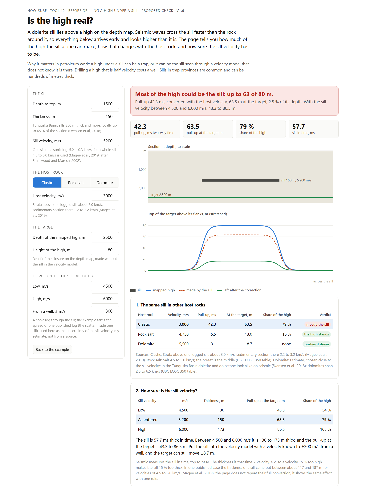

# Настоящее ли поднятие?

[English](README.md) · Русский

**Проверка перед бурением поднятия под долеритовым силлом: какую часть поднятия силл может сделать сам, подтягивая сейсмическое время вверх?**

Для геологов, которые картируют структуры под силлами трапповых провинций в осадочных бассейнах. Опишите силл, вмещающую породу и поднятие на карте глубин. Страница покажет, насколько велико подтягивание у цели, какую долю поднятия оно может объяснить, как это меняется, если вмещающая порода не терригенная, а соль или доломит, и насколько точно нужно знать скорость в силле.

Зачем это в нефтяной геологии: сейсмическая волна проходит быстрый силл скорее, чем породу вокруг, поэтому всё, что ниже, приходит раньше и выглядит выше. Карта глубин, построенная по скоростной модели без силла, показывает поднятие, которое отчасти или целиком может быть силлом. Бурить поднятие, наполовину сделанное скоростью, значит потерять скважину.

**[Открыть страницу](https://maxim-balaguroff.github.io/how-sure/12-is-the-high-real/is-the-high-real.html)** · [скачать файл](https://github.com/maxim-balaguroff/how-sure/releases/latest/download/is-the-high-real.html) (один HTML-файл, работает без интернета в любом браузере). Интерфейс страницы на английском. Одна страница для печати: [RU](is-the-high-real-one-page.ru.pdf) · [EN](is-the-high-real-one-page.pdf)

Стадия: предложенная проверка. Пример выдуман и не описывает ни один проект.

## Что она показывает

1. **Насколько велико подтягивание.** В миллисекундах двойного времени и в метрах у цели после пересчёта времени в глубину по скорости вмещающей породы. Так бывает, когда силла нет в скоростной модели.
2. **Какую долю поднятия оно может составлять.** Подтягивание против амплитуды закартированного поднятия, с выводом: силлом может быть не меньше половины поднятия (красный), от пятой части до половины (жёлтый), меньше пятой части (зелёный). Силл медленнее вмещающей породы прогибает горизонт под собой вниз и подтягивания не даёт; крылья рядом с ним могут тогда выглядеть относительно приподнятыми, их страница не оценивает.
3. **Как на это влияет вмещающая порода.** Тот же силл в терригенном разрезе, в каменной соли и в доломите, рядом. В быстром доломите или соли долеритовый силл даёт малое подтягивание или не даёт его вовсе.
4. **Насколько точно нужна скорость в силле.** Сейсмика меряет силл во времени. Если скорость завышена на 15 %, мощность силла выйдет завышенной на 15 %, а оценка подтягивания изменится сильнее: в примере примерно на 35 %. Скважина с акустическим каротажем сужает разброс скорости; страница показывает, что остаётся у цели.

Может ли гравика или магнитка ограничить силл, его мощность и края, разбирает [инструмент 11](../11-gravity-or-magnetics/).

## Пример (выдуманный)

Долеритовый силл: кровля 1500 м, мощность 150 м, скорость 5200 м/с, в терригенном разрезе со скоростью 3000 м/с. На карте глубин поднятие амплитудой 80 м на глубине 2500 м, построенное без силла в скоростной модели. Скорость в силле лежит между 4500 и 6000 м/с; скважина сузила бы её примерно до ±300 м/с (моя оценка; см. источники ниже).

- **Подтягивание:** 42,3 мс двойного времени; по скорости вмещающей породы это 63,5 м у цели, 2,5 % её глубины.
- **Доля поднятия:** 79 %. Большая часть поднятия может быть силлом.
- **Вмещающая порода:** в каменной соли со скоростью 4750 м/с тот же силл даёт 5,5 мс и 13,0 м (16 % поднятия, поднятие стоит). В доломите со скоростью 5500 м/с силл медленнее вмещающей породы и прогибает горизонт на 8,7 м.
- **Скорость в силле:** во времени силл занимает 57,7 мс. При скорости от 4500 до 6000 м/с его мощность 130–173 м, подтягивание 43,3–86,5 м, то есть от 54 % до 108 % поднятия. Если силл заложен в скоростную модель со скоростью, известной до ±300 м/с, цель всё ещё может сместиться на ±8,7 м.

## Как это работает

Лучи идут вертикально через плоские слои. Силл мощностью t волна проходит за 2t / Vs вместо 2t / Vh, поэтому всё, что ниже, приходит раньше на

ΔT = 2t (1 / Vh − 1 / Vs).

При пересчёте в глубину по скорости вмещающей породы (так бывает, когда в скоростной модели силла нет) цель выходит выше на

Δz = ΔT · Vh / 2 = t (1 − Vh / Vs).

Покрывающая толща над силлом сокращается: она одна и та же с силлом и без него, поэтому страница её не спрашивает. Сейсмика даёт силл во времени, τ = 2t / Vs. С другой скоростью V его мощность становится τV / 2, а оценка подтягивания (τ / 2)(V − Vh). Если силл заложен в скоростную модель со скоростью, ошибочной на δV, цель смещается на (τ / 2) δV.

Правила: доля поднятия равна Δz, делённому на амплитуду поднятия. Не меньше 50 %: красный, от 20 до 50 %: жёлтый, меньше 20 %: зелёный. Эти пороги я выбрал сам, это условность.

## Цифры и их источники

Каждая цифра на странице взята из открытого источника, сверенного по его странице, или помечена как мой выбор.

| Цифра на странице | Источник | Статус |
|---|---|---|
| Скорость в силле 5200 м/с; ±300 м/с для скважины | Один силл по акустическому каротажу: средняя интервальная скорость 5,2 км/с, стандартное отклонение 0,3 км/с (Magee et al., 2019). Это разброс значений акустики внутри одного силла; страница берёт его как неопределённость скорости силла после увязки со скважиной; вдали от скважины скорость может меняться сильнее | проверено по открытой странице; использование как неопределённости средней скорости: оценка, не из источника |
| Разброс скорости в силле 4500–6000 м/с | Так берут для силла целиком у Magee et al. (2019) вслед за Smallwood and Maresh (2002) | проверено по открытой странице (Magee); Smallwood and Maresh по цитате |
| Мощность 117–187 м при 4,5–6,0 км/с | Magee et al. (2019), их полный пересчёт. Страница его не повторяет; она показывает тот же эффект по τV / 2 (130–173 м на своём примере) | проверено по открытой странице |
| Терригенная вмещающая порода 3000 м/с | Около 3,0 км/с в толще над силлом с каротажем; 2,2–3,2 км/с в этом разрезе (Magee et al., 2019) | проверено по открытой странице |
| Каменная соль 4750 м/с | Середина диапазона 4,5–5,0 км/с для соли (таблица грубых диапазонов курса UBC EOSC 350) | проверено по открытой странице; середину выбрал я |
| Доломит 5500 м/с | Оценка, выбрана близко к скорости в силле: по Svensen et al. 2018 долерит и доломит на сейсмике похожи; диапазон для доломитов 2,5–6,5 км/с (UBC) | диапазон проверен; значение: оценка, не из источника |
| Мощность силла 150 м; силлы 350 м и мощнее | Тунгусский бассейн: силлы мощностью не меньше 350 м, местами до 65 % разреза (Svensen et al., 2018) | проверено по открытой странице; 150 м: мой пример |
| Долерит и доломит похожи на сейсмике | Svensen et al. (2018) | проверено по открытой странице |
| Доля поднятия, пороги 50 % и 20 % | Мои условности | оценка, не из источника |

## Где этот вопрос встаёт на Аравийской плите

Для скоростей верхней части разреза авторы из Saudi Aramco опубликовали «a novel 3D simultaneous joint inversion scheme for gravity and seismic travel-time data» (новую схему 3D одновременной совместной инверсии гравики и сейсмических времён пробега) (Colombo, Rovetta and Sandoval Curiel, 2014). В более ранней работе по югу Руб-эль-Хали, с соавторами из двух других организаций, сказано, что увязка сейсмики с несейсмическими данными (гравика, электроразведка) «can solve the shallow velocity modeling problem» (может решить задачу скоростной модели верхней части разреза) (Colombo et al., 2010). Эти работы о верхней части разреза. Эта страница задаёт вопрос о скорости силла глубже в разрезе; инструмент 11 разбирает, что гравика и магнитка могут сказать об этом силле.

## Сверено с известными ответами

На странице 26 проверок, итог внизу: **ALL 26 PASS** (проверено в Microsoft Edge). Каждая проверка сравнивает страницу с ответом, полученным другим путём:

- **вручную**, по соотношениям выше: подтягивание примера; нулевое подтягивание, когда силл так же быстр, как вмещающая порода; прогиб, когда он медленнее; подтягивание, стремящееся к мощности для очень быстрого силла; удвоение подтягивания при удвоении мощности; мощность по собственному времени при собственной скорости; 15 % скорости дают 15 % мощности; доля и пороги вывода;
- **независимым расчётом** ([`physics_ref.py`](physics_ref.py)): он строит скоростной каротаж с шагом 1 см, с медленной покрывающей толщей, которой у страницы нет, складывает двойное время по ячейкам, переводит время обратно в глубину делением пополам и находит мощность по времени тоже делением пополам, а не по τV / 2. Общая у него со страницей модель, не код. Запуск `python physics_ref.py`: он печатает каждое значение против страницы и заканчивает строкой **ALL 14 PASS**.

Если поменять код и сломать формулу, строка станет FAIL.

## Ограничения

- Вертикальные лучи и плоские слои. Под силлом уже зоны Френеля подтягивание размазано и меньше, а на краях силла преломление лучей искажает изображение. Страница даёт полное подтягивание под серединой широкого силла; более узкий силл и сглаживание при построении сейсмического изображения дают меньше.
- Силл одной мощности под всей картой поднимает всё ниже себя на одну величину и поднятия не делает. Подтягивание становится рельефом только там, где силл лежит под сводом, а на крыльях он тоньше, медленнее или его нет. Страница сравнивает полное подтягивание с амплитудой поднятия, то есть берёт случай, когда под крыльями силла нет.
- Скоростные модели по скоростям суммирования или томографии часто уже частично содержат силл, размазанный на более мощный интервал. Страница считает, что его в модели нет совсем, поэтому при заданной скорости её цифра наибольшая.
- Один силл и одна скорость вмещающей породы. Силлы в несколько этажей складываются; если скорость вмещающей породы меняется с глубиной, нужны свои интервальные скорости.
- Предполагается, что силл верно прослежен во времени, кровля и подошва. Если подошвы не видно, неопределённа сама мощность во времени; этот вопрос инструмент 11 задаёт гравике и магнитке.
- Без анизотропии и без глубинной миграции до суммирования. Страница ставит вопрос; ответ в проекте даёт скоростная модель с силлом, увязанная со скважинами.
- Страница проверяет одну причину ложного поднятия. Соль, неглубокие врезы и статика требуют своих проверок.

## Файлы

| Файл | Что это |
|---|---|
| [`is-the-high-real.html`](is-the-high-real.html) | Страница: один файл, интернет не нужен, данные не покидают браузер |
| [`is-the-high-real-one-page.ru.pdf`](is-the-high-real-one-page.ru.pdf) | Одна страница для печати, русский |
| [`is-the-high-real-one-page.pdf`](is-the-high-real-one-page.pdf) | Одна страница для печати, английский |
| [`physics_ref.py`](physics_ref.py) | Независимые суммы для проверок (Python, numpy) |
| `screenshot-page.png` | Страница на примере |

Проверка опирается на работу автора по снижению геологической неопределённости в структурно сложных системах: сейсмика, скважины, гравимагнитные данные, керн, лабораторные и полевые данные сводятся в согласованные геологические модели.

Связанная работа: моя статья «Integrated Geophysical Interpretation for Geological Modeling of a Structurally Complex Region Influenced by Salt Tectonics and Magmatism (Eastern Siberia, Russia)», Springer, IFEDC 2025, [doi:10.1007/978-981-95-9869-4_83](https://doi.org/10.1007/978-981-95-9869-4_83).

Литература: Magee, C., Hoggett, M., Jackson, C. A.-L., Jones, S. M. (2019). Burial-related compaction modifies intrusion-induced forced folds: implications for reconciling roof uplift mechanisms using seismic reflection data. *Frontiers in Earth Science*, 7:37. [doi:10.3389/feart.2019.00037](https://doi.org/10.3389/feart.2019.00037). Smallwood, J. R., Maresh, J. (2002), по цитате у Magee et al. (2019). Svensen, H. H. et al. (2018). Sills and gas generation in the Siberian Traps. *Phil. Trans. R. Soc. A*, 376, 20170080. [doi:10.1098/rsta.2017.0080](https://doi.org/10.1098/rsta.2017.0080). University of British Columbia, EOSC 350. Seismic velocities and materials, [eoas.ubc.ca/courses/eosc350](https://www.eoas.ubc.ca/courses/eosc350/content/foundations/properties/velocity.htm). Colombo, D. et al. (2010). The role of non-seismic methods in near-surface solutions: applications of seismic-gravity joint inversion and redatuming in South Rub Al-Khali, Saudi Arabia. GEO 2010, *Search and Discovery* 90105. Colombo, D., Rovetta, D., Sandoval Curiel, E. (2014). Near-surface velocity characterization through 3D joint inversion of seismic travel-times and gravity data. GEO 2014, *Search and Discovery* 90188.

Сделано с помощью ИИ; геология и проверки мои.

Лицензия: [CC BY 4.0](../LICENSE). Максим Балагуров, геолог-нефтяник · v1.6 · DOI [10.5281/zenodo.24242389](https://doi.org/10.5281/zenodo.24242389)
