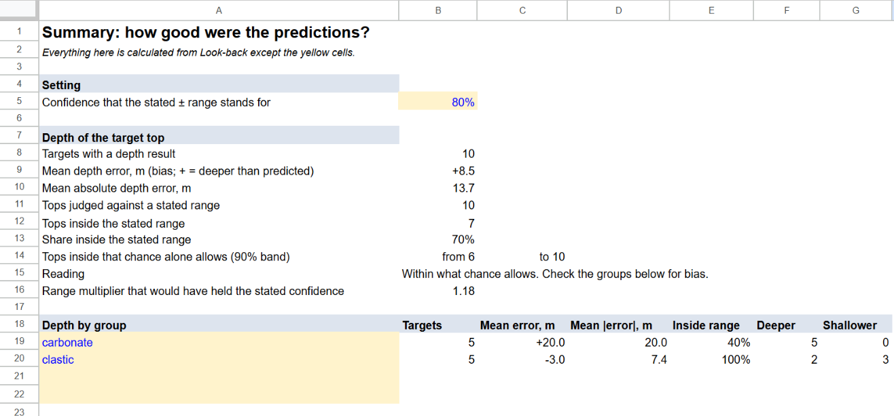

# how-sure

English · [Русский](README.ru.md)

Small tools and notes from my work as a petroleum geologist. Each one deals with the same question: how sure are we, and what would make us surer?

Each tool is a single file that opens in a few seconds. The numbers are made up or come from open sources; nothing here comes from a client or an employer. A tool that calculates something ships with an example worked out by hand and built-in checks against it, so you can test the formulas before you trust them.

## Tools

The tools fall into three families. **Before the money is spent:** what to measure and where, so that the data can answer the question it is bought for (02, a magnetic survey; 03, a shallow drilling campaign), with a brief for the survey operator (09) and which field, or which pair of field and data, answers the question (11); how much a prospect may hold, as a range, with the data that could change the decision (04); a fault checked before it goes into the framework (05); and whether a mapped high is real or made by a sill (12). **After the well:** what the result says about the prediction (01), which also shows how wide the ranges in 04 should be. **Before the data go into the database:** which of several documents is right about a well (06). And one check for the tools around the work: whether a document search answers from the page before it is accepted (07).

| | Tool | What it does | Files |
|---|---|---|---|
| 01 | [Prediction vs. result](01-prediction-vs-result/) | Post-drill look-back. For every target: the prediction, what the bit found, the difference, its cause, and what changes in the next recommendation. Shows bias by group, how often your ± ranges held once chance is allowed for, and hits that were right for the wrong reason. | [Excel](https://github.com/maxim-balaguroff/how-sure/raw/main/01-prediction-vs-result/prediction-vs-result.xlsx) · PDF [EN](01-prediction-vs-result/prediction-vs-result-one-page.pdf) [RU](01-prediction-vs-result/prediction-vs-result-one-page.ru.pdf) |
| 02 | [Magnetic survey check](02-magnetic-survey-check/) | What must the survey resolve? Checks a planned magnetic survey before it is flown: for a dyke, a sill edge or a plug, does it stand above the noise, do two bodies show as two, how far apart can the lines be, and what changes between ground, low-clearance UAV, helicopter and fixed-wing heights. | [Open the page](https://maxim-balaguroff.github.io/how-sure/02-magnetic-survey-check/magnetic-survey-check.html) · [HTML](https://github.com/maxim-balaguroff/how-sure/releases/latest/download/magnetic-survey-check.html) |
| 03 | [Five wells: which five?](03-shallow-wells-plan/) | Planning a shallow stratigraphic drilling campaign when only a few wells are allowed: what each next well buys, why dating is the weak link rather than coring, and how the first cores change the wells still to drill. Behind it is a published campaign, the first on the Russian Arctic shelf: 10 wells, 300 m of core, 13 stratigraphic units. | [Open the page](https://maxim-balaguroff.github.io/how-sure/03-shallow-wells-plan/shallow-wells-plan.html) · [HTML](https://github.com/maxim-balaguroff/how-sure/releases/latest/download/shallow-wells-plan.html) · PDF [EN](03-shallow-wells-plan/five-wells-one-page.pdf) [RU](03-shallow-wells-plan/five-wells-one-page.ru.pdf) |
| 04 | [How much, and how sure?](04-volume-range/) | A prospect's oil in place as a range, P90 to P10: why the low case is not every input at its low end, which inputs drive the range, and which data could change the decision. The same calculation as a Monte Carlo spreadsheet. | [Open the page](https://maxim-balaguroff.github.io/how-sure/04-volume-range/volume-range.html) · [HTML](https://github.com/maxim-balaguroff/how-sure/releases/latest/download/volume-range.html) · [Excel](https://github.com/maxim-balaguroff/how-sure/raw/main/04-volume-range/volume-range.xlsx) · PDF [EN](04-volume-range/volume-range-one-page.pdf) [RU](04-volume-range/volume-range-one-page.ru.pdf) |
| 05 | [When did the fault move?](05-fault-timing/) | One fault on a depth section, checked before it goes into the fault framework: which intervals it grew through, which of those calls are larger than the pick uncertainty, and whether the reservoir faces its seal across the fault. | [Open the page](https://maxim-balaguroff.github.io/how-sure/05-fault-timing/fault-timing.html) · [HTML](https://github.com/maxim-balaguroff/how-sure/releases/latest/download/fault-timing.html) · PDF [EN](05-fault-timing/fault-timing-one-page.pdf) [RU](05-fault-timing/fault-timing-one-page.ru.pdf) |
| 06 | [Which document is right?](06-which-document/) | Historical wells, several documents each, and the values do not agree. Sorts every difference by its cause (another coordinate system, X and Y swapped, a zone number in front of the easting, depths from ground level, from another rig's KB or in feet, a magnetic survey or one written 180° off, tops written as elevations) and leaves to the geologist the ones that need a choice. Gives the accepted values as CSV and a GeoPackage layer, each row with its source and whether a decision is still pending. One well in a form, or many from a table. | [Open the page](https://maxim-balaguroff.github.io/how-sure/06-which-document/which-document.html) · [HTML](https://github.com/maxim-balaguroff/how-sure/releases/latest/download/which-document.html) · PDF [EN](06-which-document/which-document-one-page.pdf) [RU](06-which-document/which-document-one-page.ru.pdf) |
| 07 | [Is the answer on the page it cites?](07-library-acceptance/) | An acceptance check for a system that searches your documents and answers questions with a page reference. About forty questions of seven kinds, one grade per answer: how often the answer came from the right page, what the system does where the documents have no answer, and which kinds of question it gets wrong. | [Open the page](https://maxim-balaguroff.github.io/how-sure/07-library-acceptance/library-acceptance.html) · [HTML](https://github.com/maxim-balaguroff/how-sure/releases/latest/download/library-acceptance.html) · [Excel](https://github.com/maxim-balaguroff/how-sure/raw/main/07-library-acceptance/library-acceptance.xlsx) · PDF [EN](07-library-acceptance/library-acceptance-one-page.pdf) [RU](07-library-acceptance/library-acceptance-one-page.ru.pdf) |
| 09 | [UAV survey brief](09-uav-survey-brief/) | The next step after tool 02: a template the geologist gives to a licensed survey operator before a UAV magnetic survey (the question and the decision, the target, the survey requirements, the accepted data and the stop points). A filled example uses the dyke of tool 02. | PDF [EN](09-uav-survey-brief/uav-survey-brief.pdf) [RU](09-uav-survey-brief/uav-survey-brief.ru.pdf) · Word [EN](09-uav-survey-brief/uav-survey-brief.docx) [RU](09-uav-survey-brief/uav-survey-brief.ru.docx) |
| 11 | [Gravity, magnetics or both?](11-gravity-or-magnetics/) | A sill with its top known from seismic. What gravity and magnetics each see from the ground, a UAV or an aircraft, what one field alone cannot tell apart, and which pair of field and data (seismic top, a well) pins the thickness. Proposed programme. | [Open the page](https://maxim-balaguroff.github.io/how-sure/11-gravity-or-magnetics/gravity-or-magnetics.html) · [HTML](https://github.com/maxim-balaguroff/how-sure/releases/latest/download/gravity-or-magnetics.html) · PDF [EN](11-gravity-or-magnetics/gravity-or-magnetics-one-page.pdf) [RU](11-gravity-or-magnetics/gravity-or-magnetics-one-page.ru.pdf) |
| 12 | [Is the high real?](12-is-the-high-real/) | A mapped high under a dolerite sill. How much of the high the sill alone can make by pulling the seismic time up, how a salt or dolomite host changes it, and how sure the sill velocity has to be. Proposed check. | [Open the page](https://maxim-balaguroff.github.io/how-sure/12-is-the-high-real/is-the-high-real.html) · [HTML](https://github.com/maxim-balaguroff/how-sure/releases/latest/download/is-the-high-real.html) · PDF [EN](12-is-the-high-real/is-the-high-real-one-page.pdf) [RU](12-is-the-high-real/is-the-high-real-one-page.ru.pdf) |

## Using a tool

1. Download the file from its folder, or open the page in the browser.
2. Look at the checks first. With the example in place they read ALL PASS (tool 01, Test sheet: ALL 32 PASS; tool 02, bottom of the page: ALL 24 PASS; tool 03, bottom of the page: ALL 49 PASS; tool 04, bottom of the page: ALL 74 PASS, and the Test sheet of its spreadsheet: ALL 38 PASS; tool 05, bottom of the page: ALL 58 PASS; tool 06, bottom of the page: ALL 130 PASS; tool 07, bottom of the page: ALL 112 PASS, and the Test sheet of its spreadsheet: ALL 38 PASS; brief 09: `check_numbers.py` prints ALL 44 PASS; tool 11, bottom of the page: ALL 38 PASS; tool 12, bottom of the page: ALL 26 PASS).
3. Then put in your own numbers.

If a number looks wrong, please [open an issue](https://github.com/maxim-balaguroff/how-sure/issues).

## Licence and citation

Text and templates: [CC BY 4.0](LICENSE). Use them, change them, credit the source.

To cite: Balagurov, M. (2026). *how-sure: small tools and notes from a petroleum geologist's work* (v1.6). Zenodo. [https://doi.org/10.5281/zenodo.24242389](https://doi.org/10.5281/zenodo.24242389). The DOI always points to the latest version; the *Cite this repository* button gives other formats.

Built with AI assistance; the geology and the checks are mine.

Maxim Balagurov · [LinkedIn](https://www.linkedin.com/in/balagurov)
