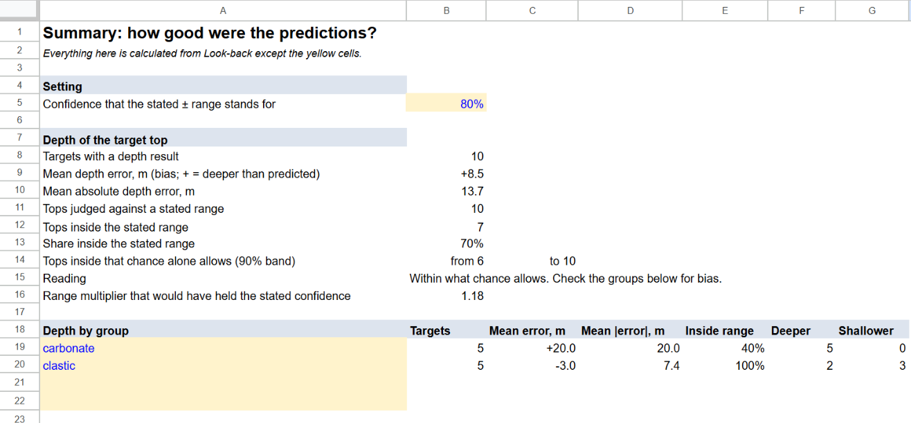

# how-sure

[English](README.md) · Русский

Небольшие инструменты и заметки из моей работы геолога-нефтяника. Каждый отвечает на один и тот же вопрос: насколько мы уверены и что сделало бы нас увереннее?

Каждый инструмент умещается в один файл и открывается за несколько секунд. Числа выдуманы или взяты из открытых источников; от заказчиков и работодателей здесь ничего нет. У инструмента, который что-то считает, есть пример с ответом, посчитанным вручную, и встроенные проверки по нему: формулы можно проверить, прежде чем им доверять.

## Инструменты

Инструменты делятся на три семейства. **До того, как потрачены деньги:** что измерять и где, чтобы данные ответили на вопрос, ради которого их покупают (02, магнитная съёмка; 03, мелкое бурение), с заданием исполнителю съёмки (09) и какое поле или какая пара поля и данных отвечает на вопрос (11); сколько может содержать перспективный объект, диапазоном, с данными, которые могли бы изменить решение (04); разлом, проверенный до того, как он войдёт в каркас (05); и настоящее ли поднятие на карте или его сделал силл (12). **После скважины:** что результат говорит о прогнозе (01); он же показывает, насколько широкими должны быть диапазоны в 04. **До того, как данные попадут в базу:** какой из нескольких документов прав о скважине (06). И одна проверка инструментов вокруг работы: отвечает ли поиск по документам по странице, прежде чем его принять (07).

| | Инструмент | Что делает | Файлы |
|---|---|---|---|
| 01 | [Прогноз против результата](01-prediction-vs-result/README.ru.md) | Разбор после бурения. По каждой цели: прогноз, что вскрыло долото, расхождение, его причина и что меняется в следующей рекомендации. Показывает смещение по группам, как часто держались диапазоны ± с поправкой на случай и попадания по неверной причине. | [Excel](https://github.com/maxim-balaguroff/how-sure/raw/main/01-prediction-vs-result/prediction-vs-result.xlsx) · PDF [RU](01-prediction-vs-result/prediction-vs-result-one-page.ru.pdf) [EN](01-prediction-vs-result/prediction-vs-result-one-page.pdf) |
| 02 | [Проверка магнитной съёмки](02-magnetic-survey-check/README.ru.md) | Что должна разрешить съёмка? Проверяет задуманную магнитную съёмку до того, как её выполнят: для дайки, края силла или штока, поднимется ли тело над шумом, покажутся ли два тела двумя, какой нужен шаг профилей и что меняется между наземной съёмкой, UAV на малой высоте, вертолётом и самолётом. | [Открыть страницу](https://maxim-balaguroff.github.io/how-sure/02-magnetic-survey-check/magnetic-survey-check.html) · [HTML](https://github.com/maxim-balaguroff/how-sure/releases/latest/download/magnetic-survey-check.html) |
| 03 | [Пять скважин: какие пять?](03-shallow-wells-plan/README.ru.md) | Как планировать мелкое стратиграфическое бурение, когда скважин мало: что даёт каждая следующая скважина, почему слабое звено датировка, а не керн, и как первые керны меняют оставшиеся скважины. За ним стоит опубликованная кампания, первая на российском арктическом шельфе: 10 скважин, 300 м керна, 13 стратиграфических подразделений. | [Открыть страницу](https://maxim-balaguroff.github.io/how-sure/03-shallow-wells-plan/shallow-wells-plan.html) · [HTML](https://github.com/maxim-balaguroff/how-sure/releases/latest/download/shallow-wells-plan.html) · PDF [RU](03-shallow-wells-plan/five-wells-one-page.ru.pdf) [EN](03-shallow-wells-plan/five-wells-one-page.pdf) |
| 04 | [Сколько и насколько уверенно?](04-volume-range/README.ru.md) | Геологические ресурсы нефти перспективного объекта как диапазон от P90 до P10: почему нижняя оценка не равна произведению нижних значений, какие параметры дают основной разброс и какие данные могли бы изменить решение. Тот же расчёт есть в таблице Монте-Карло. | [Открыть страницу](https://maxim-balaguroff.github.io/how-sure/04-volume-range/volume-range.html) · [HTML](https://github.com/maxim-balaguroff/how-sure/releases/latest/download/volume-range.html) · [Excel](https://github.com/maxim-balaguroff/how-sure/raw/main/04-volume-range/volume-range.xlsx) · PDF [RU](04-volume-range/volume-range-one-page.ru.pdf) [EN](04-volume-range/volume-range-one-page.pdf) |
| 05 | [Когда двигался разлом?](05-fault-timing/README.ru.md) | Один разлом на глубинном разрезе, проверенный до того, как он войдёт в каркас разломов: пока накапливались какие интервалы, он рос, какие из этих разниц мощностей превышают неопределённость пикировки и контактирует ли коллектор по разлому со своей покрышкой. | [Открыть страницу](https://maxim-balaguroff.github.io/how-sure/05-fault-timing/fault-timing.html) · [HTML](https://github.com/maxim-balaguroff/how-sure/releases/latest/download/fault-timing.html) · PDF [RU](05-fault-timing/fault-timing-one-page.ru.pdf) [EN](05-fault-timing/fault-timing-one-page.pdf) |
| 06 | [Какой документ прав?](06-which-document/README.ru.md) | Исторические скважины, по несколько документов на каждую, и значения не совпадают. Относит каждое расхождение к своей причине (другая система координат, переставлены X и Y, номер зоны перед восточной координатой, глубины от уровня земли, от стола ротора другой установки или в футах, магнитный азимут или развёрнутый на 180°, отбивки в абсолютных отметках) и оставляет геологу те, где нужен выбор. Выгружает принятые значения в CSV и слой GeoPackage, у каждой строки источник и пометка, ждёт ли она решения. Одна скважина в форме или много из таблицы. | [Открыть страницу](https://maxim-balaguroff.github.io/how-sure/06-which-document/which-document.html) · [HTML](https://github.com/maxim-balaguroff/how-sure/releases/latest/download/which-document.html) · PDF [RU](06-which-document/which-document-one-page.ru.pdf) [EN](06-which-document/which-document-one-page.pdf) |
| 07 | [Есть ли ответ на указанной странице?](07-library-acceptance/README.ru.md) | Приёмочная проверка системы, которая ищет по вашим документам и отвечает на вопросы со ссылкой на страницу. Около сорока вопросов семи видов, одна оценка на ответ: как часто ответ взят с верной страницы, что система делает там, где в документах ответа нет, и на каких видах вопросов ошибается. | [Открыть страницу](https://maxim-balaguroff.github.io/how-sure/07-library-acceptance/library-acceptance.html) · [HTML](https://github.com/maxim-balaguroff/how-sure/releases/latest/download/library-acceptance.html) · [Excel](https://github.com/maxim-balaguroff/how-sure/raw/main/07-library-acceptance/library-acceptance.xlsx) · PDF [RU](07-library-acceptance/library-acceptance-one-page.ru.pdf) [EN](07-library-acceptance/library-acceptance-one-page.pdf) |
| 09 | [Задание на UAV-съёмку](09-uav-survey-brief/README.ru.md) | Следующий шаг после инструмента 02: шаблон, который геолог передаёт лицензированному исполнителю перед UAV-магнитной съёмкой (вопрос и решение, цель, требования к съёмке, приёмка данных и контрольные точки). Заполненный пример на дайке инструмента 02. | PDF [RU](09-uav-survey-brief/uav-survey-brief.ru.pdf) [EN](09-uav-survey-brief/uav-survey-brief.pdf) · Word [RU](09-uav-survey-brief/uav-survey-brief.ru.docx) [EN](09-uav-survey-brief/uav-survey-brief.docx) |
| 11 | [Гравика, магнитка или обе?](11-gravity-or-magnetics/README.ru.md) | Силл, кровля которого известна по сейсмике. Что увидят гравика и магнитка с земли, с UAV и с самолёта, чего одно поле не различает и какая пара поля и данных (кровля по сейсмике, скважина) закрепляет мощность. Предложенная программа. | [Открыть страницу](https://maxim-balaguroff.github.io/how-sure/11-gravity-or-magnetics/gravity-or-magnetics.html) · [HTML](https://github.com/maxim-balaguroff/how-sure/releases/latest/download/gravity-or-magnetics.html) · PDF [RU](11-gravity-or-magnetics/gravity-or-magnetics-one-page.ru.pdf) [EN](11-gravity-or-magnetics/gravity-or-magnetics-one-page.pdf) |
| 12 | [Настоящее ли поднятие?](12-is-the-high-real/README.ru.md) | Поднятие на карте под долеритовым силлом. Какую часть поднятия силл может сделать сам, подтянув сейсмическое время, как это меняют соль и доломит и насколько точно надо знать скорость в силле. Предложенная проверка. | [Открыть страницу](https://maxim-balaguroff.github.io/how-sure/12-is-the-high-real/is-the-high-real.html) · [HTML](https://github.com/maxim-balaguroff/how-sure/releases/latest/download/is-the-high-real.html) · PDF [RU](12-is-the-high-real/is-the-high-real-one-page.ru.pdf) [EN](12-is-the-high-real/is-the-high-real-one-page.pdf) |

## Как пользоваться

1. Скачайте файл из папки инструмента или откройте страницу в браузере.
2. Сначала посмотрите проверки. Пока пример на месте, там ALL PASS (инструмент 01, лист Test: ALL 32 PASS; инструмент 02, внизу страницы: ALL 24 PASS; инструмент 03, внизу страницы: ALL 49 PASS; инструмент 04, внизу страницы: ALL 74 PASS, лист Test его таблицы: ALL 38 PASS; инструмент 05, внизу страницы: ALL 58 PASS; инструмент 06, внизу страницы: ALL 130 PASS; инструмент 07, внизу страницы: ALL 112 PASS, лист Test его таблицы: ALL 38 PASS; задание 09: `check_numbers.py` печатает ALL 44 PASS; инструмент 11, внизу страницы: ALL 38 PASS; инструмент 12, внизу страницы: ALL 26 PASS).
3. Потом внесите свои числа.

Если число выглядит неверным, [откройте issue](https://github.com/maxim-balaguroff/how-sure/issues).

## Лицензия и ссылка

Тексты и шаблоны: [CC BY 4.0](LICENSE). Можно брать и менять, указывая источник.

Как сослаться: Balagurov, M. (2026). *how-sure: small tools and notes from a petroleum geologist's work* (v1.6). Zenodo. [https://doi.org/10.5281/zenodo.24242389](https://doi.org/10.5281/zenodo.24242389). DOI всегда ведёт на последнюю версию; другие форматы даёт кнопка *Cite this repository*.

Сделано с помощью ИИ; геология и проверки мои.

Максим Балагуров · [LinkedIn](https://www.linkedin.com/in/balagurov)
